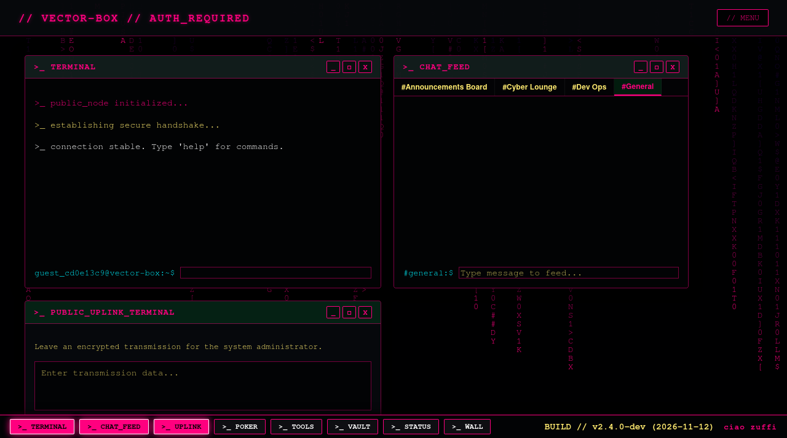
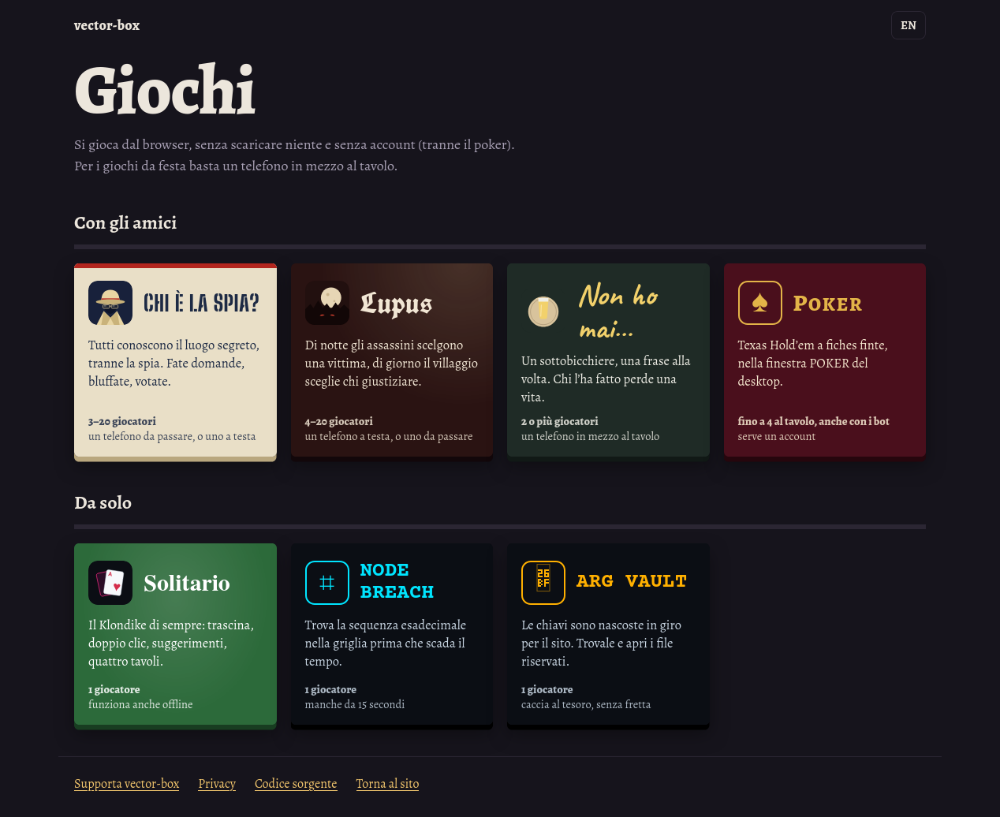

# vector-box

A cyberpunk desktop in the browser: windows, a terminal and a taskbar, with a chat (rooms and private messages), a private
book reader, party games for phones and solo games. Self-hosted on a small home server.
PHP + SQLite, with an optional Node.js hub that delivers the chat in real time.



**Full documentation (Italian): [`docs/DOCUMENTAZIONE.md`](docs/DOCUMENTAZIONE.md)** — user guide, terminal commands,
architecture, database, every API endpoint, security rules, configuration, deploy.

## What's inside

| | |
|---|---|
| **Desktop** | Draggable windows (terminal, chat, poker, tools, vault, status, guestbook wall, private messages, reader); on phones one app at a time with a tab bar. |
| **Terminal** | A fake filesystem, network toys, themes, chat commands and admin moderation (`help` lists everything). |
| **Chat** | Rooms (announcement-only and admin-only ones too), @mentions, who's online, "is typing", real-time through the hub. |
| **Private messages** | Between registered users, with blocking and older messages loading as you scroll; no admin access path. |
| **Library** | EPUB and PDF reader for allowed accounts: covers, reading progress, bookmarks, multi-file upload. |
| **Class notes** | Shared notes per school class (admin-approved classes, invite codes, per-day timetable read from a photo), a test calendar with reminders (in-site bell and Web Push), and study documents written by Google Gemini: merged lesson notes, a complete handout, summary, targeted preparation and a quiz for every test. |
| **Games** | *Who's the spy?*, *Lupus* (werewolf) and *Cucù* (an Italian card game) with multi-phone rooms, *Never have I ever…*, *Solitaire* (Klondike), *Node Breach*, *ARG Vault*, poker. Five languages for the party games. |



## Quick start

```bash
cp .env.example .env          # fill it in: Node refuses to start without SESSION_SECRET, ADMIN_PASSWORD, GUEST_PASSWORD
npm install
php -S 127.0.0.1:8080 -t public
npm start                     # optional: the chat hub
npm test                      # 101 automated tests, each run on a throwaway copy of the site
```

Requirements: PHP 8 with `pdo_sqlite`, `curl`, `zip`, `xml` (`mbstring` recommended); Node.js 22.

- Serve **only** `public/`; `data/` (SQLite, sessions, books, logs) lives outside it and is created automatically.
- Behind a reverse proxy set `TRUSTED_PROXIES` (PHP) and `TRUST_PROXY` (Node).
- Schema changes: a new `migrateVN()` in `public/api/database.php` plus `DB_SCHEMA_VERSION` (tracked with
  `PRAGMA user_version`, currently 11).
- Deploy on the server with `sudo bash updatesite.sh` (see [`docs/DEPLOY.md`](docs/DEPLOY.md)); nightly backups:
  [`docs/BACKUP.md`](docs/BACKUP.md).

## Chat delivery

PHP always stores the messages. With `CHAT_HUB_SECRET` and `CHAT_STREAM_URL` set, PHP pushes new and deleted messages to
the Node hub (`/internal/chat/publish`, loopback + secret only) and each browser keeps one SSE connection to
`/api/chat/stream`, authenticated with a signed token valid for **60 seconds and one connection**. On failure the browser
retries after 1, 2, 4 and 8 seconds, then falls back to `api/uplink_stream.php` and tries the hub again every minute.
Both streams resume from the last event id. Proxy only `/api/chat/stream` to Node, never `/internal/`.

## Security in short

CSRF tokens on every state-changing request, strict sessions, a Content-Security-Policy, SQLite-backed rate limits,
user text always rendered with `textContent` (AI-written Markdown too), uploads checked by content and stored outside the
web root, one-use chat stream tokens kept out of URLs, Web Push only to the browsers' push services. Details in
section 6 of the documentation.
