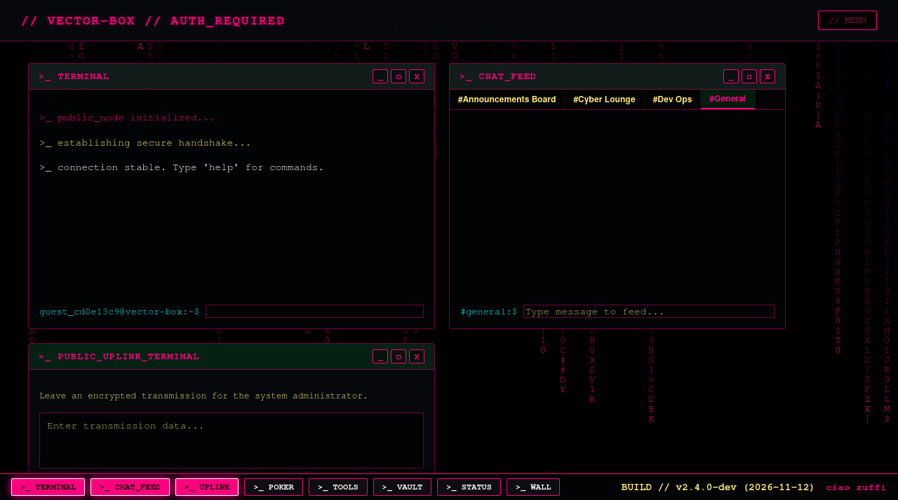
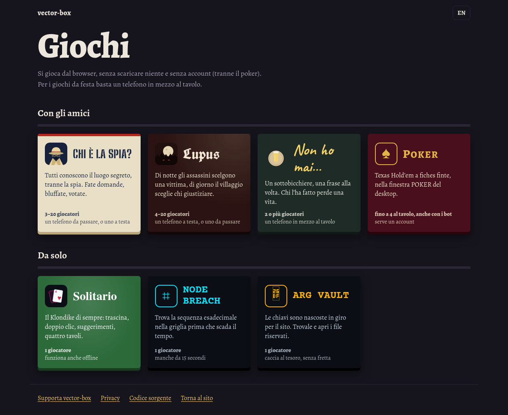

# vector-box

A home menu and a cyberpunk desktop in the browser: windows, a terminal and a taskbar. Inside it there are a chat (rooms and private
messages), a private book reader, shared class notes with AI-written study documents, party games for phones and a shelf
of solo games, and an offline copy of the Italian Wikipedia. It is self-hosted on a small home server and built by one student.

PHP + SQLite do the work; a small optional Node.js process delivers the chat in real time.



| Read this | For |
|---|---|
| [`docs/DOCUMENTAZIONE.md`](docs/DOCUMENTAZIONE.md) (Italian) | user guide, terminal commands, database, every API endpoint, security rules, configuration |
| [`docs/ARCHITETTURA.md`](docs/ARCHITETTURA.md) (Italian) | a map of the code: which file does what |
| [`docs/DEPLOY.md`](docs/DEPLOY.md) | server checklist: nginx, timers, workers |
| [`docs/BACKUP.md`](docs/BACKUP.md) | nightly backup and restore |
| [`docs/ADSENSE.md`](docs/ADSENSE.md) | turning the (optional) ads on |

## What's inside

| | |
|---|---|
| **Home menu** | The front page (`index.php`): one card each for games, class notes, offline Wikipedia, the desktop, account, news and the project, plus the private book reader and statistics only for the accounts allowed to see them. Account and sign-in pages share the site's dusk theme. |
| **Desktop** | `desktop.php`: draggable windows (terminal, chat, poker, tools, vault, status, guestbook wall, private messages, reader); on phones one app at a time with a tab bar. 18 themes. |
| **Terminal** | A fake filesystem, network toys, themes, chat commands and admin moderation (`help` lists everything). |
| **Chat** | Rooms (announcement-only and admin-only ones too), @mentions, who's online, "is typing", real-time through the hub. |
| **Private messages** | Between registered users, with blocking; no admin access path in the API. |
| **Library** | EPUB and PDF reader for allowed accounts: covers, reading progress, bookmarks, highlights and notes, labels and shelves, search inside the book, text options, filters, 16 ways to sort, reading statistics, an editable page number in the top bar, multi-file upload, an optional "like a book" page turn. |
| **Class notes** | Shared notes per school class: admin-approved classes, invite codes, roles and permissions, a timetable read from a photo, resumable uploads, full-text search, a board, a calendar with tests, homework and oral-exam turns, reminders (in-site and Web Push), temporary share links, and study documents written by Google Gemini (lesson notes, handouts, summaries, quizzes judged by the server, custom quizzes, spaced review, mind maps). The AI is used only for classes declared to be adults-only. An example class is open to everyone, read-only. |
| **Party games** | *Who's the spy?*, *Lupus* (werewolf) and *Cucù* (an Italian card game) and *Botola* (an elimination quiz, 1,400+ questions from Open Trivia DB, CC BY-SA 4.0, with an admin LIVE view), *Flags* (a quiz of flags and capitals: 150+ countries in 5 languages, flag emoji, speed scoring judged by the server, alone or on one phone too, admin LIVE view), *Most likely to…* (secret votes on funny sentences, in 5 languages, with an admin LIVE view), *Would you rather…?* (secret A/B choices, the minority scores, 5 languages, admin LIVE view), *The bomb* (hot potato with a hidden fuse chosen by the server, categories and syllables in 5 languages, lives, admin LIVE view), *Undercover* (a secret word each, one is similar but different, Mr. White has none; spoken clues, secret votes, judged by the server, 143 word pairs in 5 languages, admin LIVE view), *Mime* (team charades: the word reaches only the mime's phone, the server keeps the time, 160 words in 5 languages, admin LIVE view), *Truth or dare* (a turn-based card game: the server judges the others' vote, light questions and dares in 5 languages, spicy ones off by default, admin LIVE view), *Forbidden word* (two teams, a clue-giver, forbidden words and an opposing guardian who hits BUZZ, 120+ cards in 5 languages, server-side clock, admin LIVE view) *Lesson bingo* (the group writes typical phrases, the server deals each player a 4x4 or 5x5 card and checks every BINGO!, optional referee mode, silent, 6 starter lists in 5 languages, admin LIVE view), *Chain story* (a story written together one sentence each, seeing only the sentence before yours, a server turn timer, 60 openings in 5 languages, a secret vote on the best sentence, host moderation, admin LIVE view), *10 out of 10, but…* (one player is a 10/10 and everybody secretly finishes "… but" with a funny flaw, anonymous until the vote, a prize sentence worth double, a family word filter, 98 hint examples in 5 languages, admin LIVE view), *Guess what* (a keeper holds a secret word the server sends to their phone only, yes/no/maybe answers counted by the server, 20 questions, a server timer, one judged try each, 200 words in 5 languages, admin LIVE view), with multi-phone rooms, *Never have I ever…*, and Texas Hold'em poker with real hand ranking. Five languages for the party games. |
| **Solo games** | Solitaire (Klondike), Connect Four, Hangman, Simon, Memory, Tic-tac-toe, Snake, 2048, Minesweeper, Tetris, a word game (*Parola*), Conway's Game of Life, a tower defense (*Difesa del server*), Node Breach, ARG Vault, and a long roguelike campaign, *Il Dungeon del Server* (10 sectors, autosave, touch-first; see docs/ROGUELIKE.md). Static pages, no account needed. *Skill check* (a Dead by Daylight style timing game, with an endless mode) and *Botola* alone also run solo. Best results are kept per level on the account (**Records** section of the Account page), merged with the phone's. A page, [How vector-box works](public/pages/come-funziona.php), explains the site in three steps. |
| **Offline Wikipedia** | An optional copy of the Italian Wikipedia served by [Kiwix](https://www.kiwix.org) at `/wiki/`, with a front page (`pages/wikipedia.php`) that has a search box and the credit its licence (CC BY-SA 4.0) asks for. No ads, no tracking, nothing stored. See "Offline Wikipedia" below. |
| **Accounts and privacy** | Optional confirmed e-mail address with separate consent to news, download of all your data, account deletion, automatic data retention, a cookie banner that loads nothing from Google before consent. Public [privacy](public/pages/privacy.php) and [security](public/pages/sicurezza.php) pages. |
| **Admin** | People panel (search, permissions, ban/timeout, supporter badge), an e-mail box with a queue (off until configured), donors list and a "where the money goes" page, visit and bot statistics. |



## Quick start

Requirements: PHP 8 with `pdo_sqlite`, `curl`, `zip`, `xml`, `fileinfo` (`mbstring` recommended); Node.js 22 or newer.

```bash
cp .env.example .env              # fill it in (every key is explained in the file)
php -S 127.0.0.1:8080 -t public   # the site: open http://127.0.0.1:8080
```

That is enough for the site: the database and the `data/` folder are created at the first request. The first account
is a normal one; an admin is an account with `is_admin = 1` in the `accounts` table.

Optional parts:

```bash
npm install                       # only needed for the Node process
npm start                         # chat hub + old control panel; refuses to start without SESSION_SECRET, ADMIN_PASSWORD, GUEST_PASSWORD
php bin/appunti-ai.php            # one run of the class-notes worker (reminders; the AI part needs GEMINI_API_KEY)
php bin/mail-worker.php           # one run of the e-mail queue (says so and sends nothing while MAIL_DRIVER is empty)
```

When testing the chat stream or anything concurrent, give the PHP server more workers:
`PHP_CLI_SERVER_WORKERS=4 php -S 127.0.0.1:8080 -t public`.

## Configuration

Everything is in `.env` (never committed); `.env.example` documents each key. The groups:

- **Node secrets** (`SESSION_SECRET`, `ADMIN_PASSWORD`, `GUEST_PASSWORD`): required only by `server.js`.
- **Proxy** (`TRUSTED_PROXIES` for PHP, `TRUST_PROXY` for Node): who may set `X-Forwarded-For`.
- **Site** (`SITE_URL`, `CONTACT_EMAIL`, `CSP_ENFORCE`, `STATUS_CHECKS`).
- **Chat hub** (`CHAT_HUB_SECRET`, `CHAT_STREAM_URL`, `PORT`, `BIND_HOST`).
- **Notifications** to the owner (`NTFY_TOPIC_URL`, `VISIT_*`).
- **Class-notes AI** (`GEMINI_*`, `WHISPER_*`, `DEMO_CLASS`).
- **E-mail** (`MAIL_*`), **ads and donations** (`ADSENSE_*`, `DONATE_*`), **data retention** (`RETENTION_*_DAYS`).

Serve **only** `public/`. `data/` (SQLite database, sessions, books, class files, logs) lives outside it.

## Tests

```bash
npm test                          # needs only PHP and Node on the PATH, no npm install
node --test tests/chat.test.js    # one file
```

About 640 tests (`node:test`). Each suite starts a throwaway copy of the site on a free port with an empty database, so
the real one is never touched. Before a commit: `npm test`, `php -l` on every PHP file touched and `node --check` on
every JS file touched. Every new endpoint or page gets a test.

## Where things live

```
public/               the web root (the only folder the web server serves)
  index.php           the home menu (and the 404 / scanner handler)
  desktop.php         the desktop
  pages/              pages: games, reader, class notes, account, privacy, security, admin panels
  api/                JSON endpoints and shared libraries
    helpers.php         env, client IP, JSON answers, CSRF/login/admin guards, security headers
    database.php        connection, session start, versioned migrations (schema v45)
    rate_limiter.php    SQLite-backed rate limits
  includes/           head.php (headers, version, visit log), ads.php, appunti-top.php, home-access.php (who sees the private home cards)
  js/ css/ assets/    scripts, styles, icons, self-hosted fonts
  errors/             static error pages
  .well-known/        security.txt
bin/                  command-line workers (class-notes AI, Whisper, e-mail queue, example class)
lib/                  code shared with the tests and the Node process
server.js             Node: chat hub (SSE) and the old control panel
tests/                automated tests
tools/                backup script, generators (error pages, left-handed CSS), Whisper wrapper
docs/                 documentation
updatesite.sh         deploy script (run on the server)
data/                 (not in git) database, sessions, uploads, logs
```

## Contributing

- Keep changes small and separate; say what a commit does in its message.
- **State-changing endpoint:** call `requireCsrf()` (and `requireAdmin()` for admin ones), report errors with
  `failInternal()` (never the exception text), add `checkRateLimit()` if it can be abused, and write a test.
- **Database change:** a new `migrateVN()` in `public/api/database.php`, bump `DB_SCHEMA_VERSION`, call it from
  `runMigrations()`. No DDL on normal requests.
- **User text** goes into the page with `textContent`, never `innerHTML`.
- **Client IP:** only through `getClientIp()`.
- **New game on the Games page:** one entry in `$GAMES` at the top of `public/pages/giochi.php`.
- After changing `public/css/appunti.css` run `python3 tools/make-lefty-css.py`.
- The repository is public: no secrets, no personal data, never `.env` or `data/`.

More recipes are in section 10 of the documentation.

## Offline Wikipedia

Optional, and not part of the PHP code: the site only has the front page (`public/pages/wikipedia.php`, which names the
Kiwix "book" in `$ZIM`; Kiwix calls a book after its file, without `.zim`). The copy itself is a ZIM file from
[download.kiwix.org](https://download.kiwix.org/zim/wikipedia/) (Italian: `mini` 3 GB intro only, `nopic` 10 GB, `maxi` 30 GB with images)
served on localhost by the official image, with a URL prefix so its links stay under `/wiki`:

```bash
docker run -d --name kiwix --restart unless-stopped -p 127.0.0.1:8081:8080 -v /path/to/zim:/data:ro \
  ghcr.io/kiwix/kiwix-serve:latest --urlRootLocation /wiki wikipedia_it_all_maxi_2026-08.zim
```

nginx must send `/wiki/` to it with its own `location ^~ /wiki/ { proxy_pass http://127.0.0.1:8081; ... }`, placed **before** the
static-files rules (otherwise nginx answers 404 to every `.css`, `.js` and image under `/wiki/` itself and the pages show unstyled),
and it should hide `Set-Cookie` and add `X-Robots-Tag: noindex` (`robots.txt` already disallows `/wiki/`). Check the file's SHA-256
against the `.sha256` file next to it. The content is Wikipedia's, under CC BY-SA 4.0: keep the credit on the front page.

## Chat delivery

PHP always stores the messages. With `CHAT_HUB_SECRET` and `CHAT_STREAM_URL` set, PHP pushes new and deleted messages to
the Node hub (`/internal/chat/publish`, loopback + secret only) and each browser keeps one SSE connection to
`/api/chat/stream`, authenticated with a signed token valid for **60 seconds and one connection**. On failure the browser
falls back to `api/uplink_stream.php` and tries the hub again later. Both streams resume from the last event id. Proxy
only `/api/chat/stream` to Node, never `/internal/`.

## Security in short

Passwords stored only as hashes, login limits per address and per account, sessions re-checked against the database on
every action that needs a login, CSRF tokens on state-changing requests, a Content-Security-Policy (report-only until `CSP_ENFORCE=true`),
SQLite-backed rate limits, user text rendered with `textContent` (AI-written Markdown too), uploads checked by content and
stored outside the web root, one-use chat stream tokens, Web Push only to the browsers' push services.

The plain-language version, with the honest limits, is the site's security page (`public/pages/sicurezza.php`);
the technical one is section 6 of the documentation. **Found a vulnerability?** See
[`public/.well-known/security.txt`](public/.well-known/security.txt): please report it privately first.

## Deploy

On the server: `sudo bash updatesite.sh` (pulls `main`, keeps local edits in a stash, updates dependencies, fixes the
permissions of `data/`, runs the migrations as the PHP user, bumps the version used for cache-busting). `.env` must
already exist there. The full checklist is [`docs/DEPLOY.md`](docs/DEPLOY.md).
