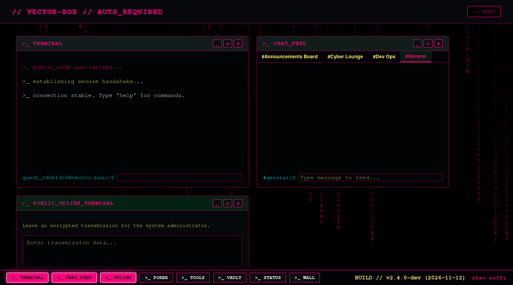
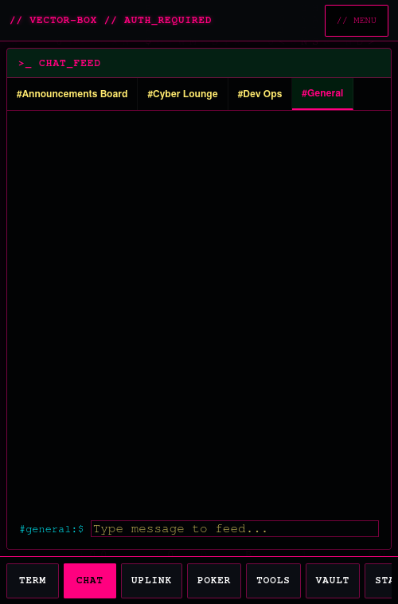
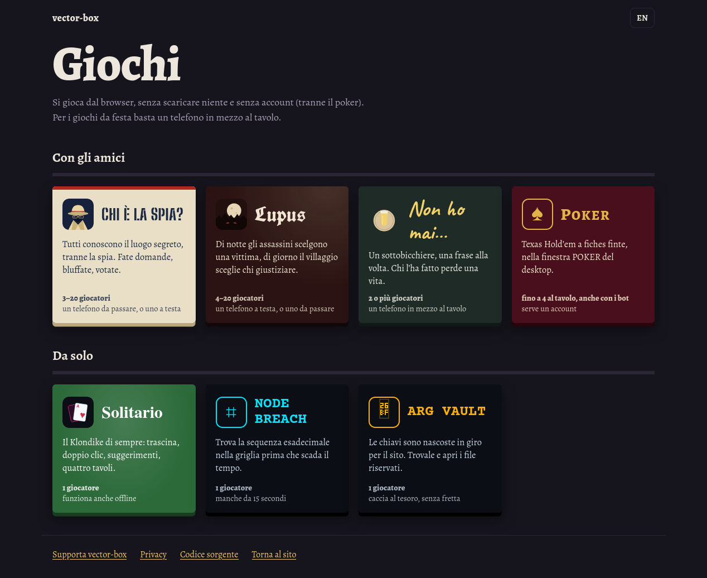
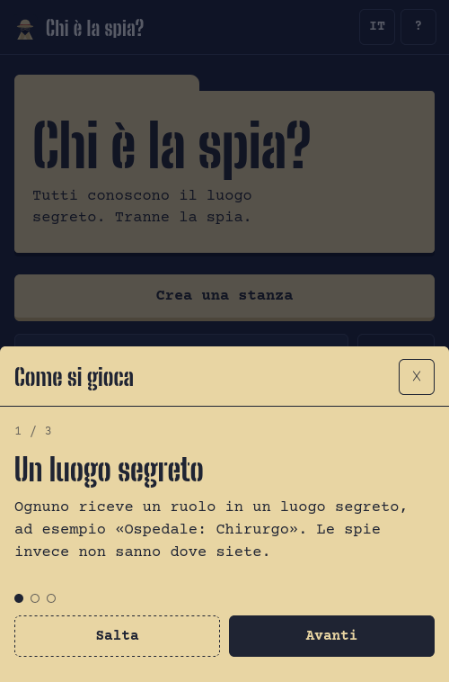
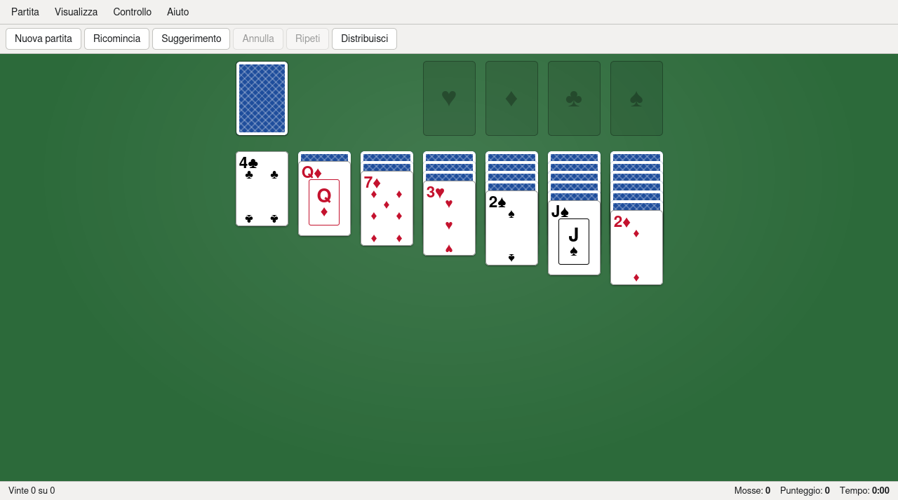

# vector-box — documentazione

> Aggiornata al 2026-11-17 (schema del database **v35**, circa 340 test). Mappa del codice: [`ARCHITETTURA.md`](ARCHITETTURA.md). Codice: <https://github.com/G1anPietro/vector-box>

vector-box è un sito personale in stile desktop cyberpunk: finestre, terminale e barra delle applicazioni nel browser.
Dentro ci sono una chat con stanze e messaggi privati, un lettore di libri privato, giochi da festa per telefono e giochi
da soli, e gli **Appunti di classe** (appunti condivisi per classe, riassunti e dispense scritti da un'AI, calendario
delle verifiche con promemoria). Gira su un piccolo server di casa (Ubuntu, nginx, PHP-FPM, Node.js).



**Indice:** [Guida per chi usa il sito](#parte-1--guida-per-chi-usa-il-sito) · [Appunti di classe](#appunti-di-classe) ·
[Comandi del terminale](#comandi-del-terminale) ·
[Documentazione tecnica](#parte-2--documentazione-tecnica) · [API](#5-api) · [Sicurezza](#6-sicurezza) ·
[Configurazione](#7-configurazione-env) · [Sviluppo](#8-sviluppo-in-locale) · [Pubblicazione](#9-pubblicazione-sul-server)

---

# Parte 1 — Guida per chi usa il sito

## Il desktop

La home è un desktop: ogni funzione è una **finestra** che si apre dalla barra in basso, si trascina, si riduce, si
ingrandisce e si chiude. Il **MENU** in alto a destra porta alle altre pagine (Giochi, Supporta, accesso, impostazioni
dell'account) e ai temi grafici. Nel menu: **interruttore del Matrix** (sfondo a pioggia; si può spegnere, anche con `matrix off` dal terminale), scanlines
(effetto CRT, solo qui, sopra tutto lo schermo) e il **tema**. Niente più modalità "night" né "high contrast". Il tema predefinito è il **monocromatico**.
I temi sono un elenco solo, in `js/theme.js` (`THEMES`) e in `api/helpers.php` (`SYSTEM_THEMES`; `tests/temi.test.js` controlla che coincidano): menu, terminale
(`theme`, `rice`) e Impostazioni dell'account usano lo stesso `setSystemTheme`, che salva la scelta sull'account (`api/save_theme.php`); le pagine scrivono il tema
dell'account in `<meta name="vb-theme">` e `theme.js` lo applica, così tutti i luoghi e tutti i dispositivi coincidono. I temi del lettore di libri (chiaro, seppia, scuro,
nero) restano nel browser; le etichette sono in inglese come l'index. Nel menu c'è anche **FROSTED GLASS** (il vetro sfocato e semitrasparente delle finestre, che rende "nebbioso" lo sfondo: spento = finestre piene) e non toccano il tema del desktop.

| Finestra | A cosa serve |
|---|---|
| **TERMINAL** | Riga di comando: `help` mostra tutti i comandi (elenco più sotto). |
| **CHAT_FEED** | La chat pubblica, divisa in stanze (le schede in alto). |
| **UPLINK** | Lascia un messaggio privato a chi gestisce il sito: arriva come notifica sul suo telefono. |
| **POKER** | Texas Hold'em con fiches finte, contro altri giocatori e bot (serve un account). |
| **TOOLS** | Strumenti: banner ASCII, ROT13/ROT47, cifrario di Cesare, Morse, binario. |
| **VAULT** | Il caveau dell'ARG: inserisci le chiavi trovate in giro per il sito. |
| **STATUS** | Stato del server: da quanto è acceso, carico, memoria, servizi. |
| **WALL** | Il muro dei graffiti: lascia una frase visibile a tutti. |
| **DM** | Messaggi privati con gli altri utenti registrati. |
| **READER** | La biblioteca (solo per gli account autorizzati). |

**Sul telefono** si vede un'app alla volta, e si cambia con la barra di schede in basso (scorre di lato). Mentre la tastiera
è aperta la barra si nasconde, poi torna.



## Account

- **Senza account** puoi leggere la chat, scrivere come ospite (`guest_` più 8 caratteri), usare il terminale e giocare
  ai giochi da festa.
- **Con un account** (MENU → LOGIN / REGISTER; password di almeno 8 caratteri) hai il tuo nome in chat, i messaggi
  privati, il poker con la classifica e il tema grafico che resta.
- La **biblioteca** e il **curriculum** si vedono solo se l'admin ti dà il permesso (`/grantbook`, `/grantcv`).
- Per registrarti confermi di aver letto la pagina privacy e di avere almeno 14 anni (o il consenso di un genitore).
  I nomi sono unici anche cambiando maiuscole e minuscole; i nomi che sembrano dello staff sono riservati.
- Nella pagina **Account**: biografia, tema, cambio password, **indirizzo e-mail facoltativo** (vale dopo il clic sul
  link di conferma; le novità del sito arrivano solo se spunti la casella a parte, e ogni messaggio ha il link per
  smettere), **scarica i tuoi dati** (un file JSON) e **cancella l'account** (chiede la password; chi gestisce una classe
  deve prima cederla o chiuderla).
- Pagine pubbliche: **Privacy** (`/pages/privacy.php`), **Sicurezza** (`/pages/sicurezza.php`: come sono protetti
  account e dati, i limiti, come segnalare una vulnerabilità), **Il progetto**, **Supporta**, **Dona** e
  **Dove vanno i soldi** (chi dona può avere il distintivo di sostenitore).

## Chat e messaggi privati

- Scegli la stanza dalle schede in alto. Alcune stanze sono solo per gli annunci (scrive solo l'admin).
- Scrivi `@nome` per menzionare qualcuno: il messaggio si evidenzia e, se ha la scheda in background, riceve una notifica.
- Quando il collegamento in tempo reale è attivo, sotto la chat vedi chi è online e chi sta scrivendo.
- **Messaggi privati (DM):** cerca un utente per nome e scrivigli. Puoi **bloccare** qualcuno: nessuno dei due potrà più
  scrivere all'altro. Scorrendo verso l'alto i messaggi più vecchi si caricano da soli. L'admin non ha un modo per leggerli.

## Biblioteca

Per chi ha il permesso: libri **EPUB** e **PDF** con copertina, scaffale "Continua a leggere", avanzamento salvato,
segnalibri, quattro colori di pagina e filtro luce blu. Nel lettore: barra in alto (indietro, segnalibro, elenco segnalibri,
**Aa**) e in basso (pagina precedente/successiva, cursore della posizione, numero di pagina). Nel pannello **Aa**: dimensione
del testo per gli EPUB (70–200%) e zoom per i PDF (50–300%, 100% = pagina intera sullo schermo, "Adatta" per tornarci),
**una pagina alla volta** o due affiancate (solo su schermi larghi), colori, filtro luce blu, scarica. Si gira pagina con le
frecce, con i bordi della pagina, con lo scorrimento del dito o con i tasti ← → (+ e − per lo zoom). Un tocco al centro
della pagina mostra o nasconde la **barra in basso**, che di base è nascosta mentre leggi ("Quando serve": compare sopra
il testo e si nasconde da sola dopo 6 secondi; in fondo resta una linea sottile con la posizione); in **Aa** si può scegliere
"Sempre". **Schermo intero** (in **Aa**) nasconde anche la barra in alto; si esce con il pulsante **✕ Esci** in alto a
destra (chiaro per qualche secondo, poi semitrasparente), un tocco al centro, il **tasto indietro** del telefono o Esc.
Il tasto indietro, nel lettore, esce prima dallo schermo intero e poi chiude il libro, senza lasciare la biblioteca.
In **Aa → Come si usa** ci sono tutti i gesti. I menu si chiudono toccando in un punto qualsiasi fuori. In biblioteca la ricerca parte mentre scrivi e
"+ Carica libri" carica appena scegli i file. Chi può caricare sceglie più file insieme o li trascina sul riquadro.

## Giochi

Tutti i giochi sono nella pagina **Giochi** (MENU → GIOCHI), in italiano e inglese.



- **Chi è la spia?** (3–20 giocatori): tutti conoscono il luogo segreto tranne le spie. Si fanno domande a turno, poi si
  vota; la spia può provare a indovinare il luogo. Si gioca con un telefono a testa (stanza con un codice di 4 lettere) o
  con un solo telefono da passare. Nelle impostazioni della stanza: numero di spie, categorie di luoghi, modalità famiglia.
- **Lupus** (4–20 giocatori): di notte gli assassini scelgono una vittima, di giorno il villaggio vota chi giustiziare.
  Ruoli della casa (puttana, joker, pescatore, giudice) e ruoli facoltativi (veggente, guardia, strega, cacciatore…).
- **Non ho mai…** (2 o più): un telefono in mezzo al tavolo, una frase alla volta; chi l'ha fatto perde una vita.
- **Cucù** (2–20, un telefono a testa): una carta a testa dal mazzo italiano. Il nuovo mazziere dice a voce le vite di
  tutti (se ne sbaglia una perde una vita e passa il mazzo); le carte si guardano dopo che il mazziere **bussa due volte**;
  a turno si tiene o si cambia col vicino, il **Re blocca** lo scambio («Cucù!»), il mazziere per ultimo può cambiare col
  mazzo; la carta più bassa perde una vita (pari merito: si ripesca). **Le vite non si vedono**, si ricordano a memoria;
  ogni vita persa o guadagnata compare su tutti i telefoni. Chi crea la stanza è il **capotavola**: conferma chi perde,
  segnala chi parla con i morti (il vivo perde una vita, il morto ne guadagna una; il mazziere può parlarci). Poteri
  facoltativi nelle impostazioni (Cavallo che salta, Re pescato dal mazzo) e un "potere dell'admin" dichiarato a tutti.
- **Solitario**: Klondike. Si gioca toccando o trascinando le carte; doppio clic per mandarle sulle pile dei semi (doppio
  clic su una pila raccoglie tutto quello che può salire). Suggerimento, annulla/ripeti, punteggio, quattro tavoli
  (Classico, Neon, Legno, Notte). Sul computer ha menu e scorciatoie: Ctrl+Z, Ctrl+Y, H (suggerimento), D (distribuisci),
  F2 (nuova partita).
- **Giochi da soli, senza account** (pagine statiche, record nel browser): **Campo minato** (3 livelli, bandierine,
  tocco lungo, tastiera), **2048** (scorrimento, frecce, WASD), **Memory** (3 livelli), **Tris** (facile, medio,
  imbattibile, o in due), **Snake** (scorrimento o tasti; si ferma quando la scheda è nascosta), **Forza 4** (computer
  a tre livelli o in due), **Impiccato** (parole italiane, 5 argomenti, serie di vittorie), **Simon** (luci e suoni).
- **Node Breach**: trova la sequenza esadecimale nella griglia in 15 secondi.
- **ARG Vault**: le chiavi sono nascoste in giro per il sito.
- **Poker**: Texas Hold'em nella finestra POKER del desktop (serve un account), fino a 4 al tavolo, anche con i bot.
  La mano migliore è scelta davvero (le cinque carte migliori su sette, kicker, scala minima A-2-3-4-5, piatto diviso
  in caso di parità); chi esce a metà mano passa il turno senza bloccare il tavolo.
- In arrivo (non ancora in questo ramo): **Tetris** e il roguelike **Il Dungeon del Server**.

 

## Appunti di classe

Dal **MENU → APPUNTI DI CLASSE** (`/pages/appunti.php`, serve un account). Ogni classe ha i suoi appunti, separati da
quelli delle altre classi e delle altre scuole.

**Entrare in una classe.** Chiedi il **codice d'invito** al responsabile della classe e scrivilo nella pagina. Se la tua
classe non c'è ancora, chiedila (classe, scuola, una nota): la approva l'amministratore, e chi l'ha chiesta ne diventa il
**responsabile**. L'amministratore può chiudere le richieste nuove quando vuole.

**Il responsabile** (scheda *Classe*): vede e rigenera il codice d'invito, toglie i compagni o passa il ruolo a un altro,
sceglie l'ora del riassunto automatico (18:00 se non la cambia) e inserisce l'**orario**:
- con **"Compila da foto o PDF"**: carica lo screenshot dell'orario e, se c'è, la foto degli orari della campanella;
  l'AI riempie la tabella, lui la controlla e preme *Salva l'orario*;
- oppure a mano: per ogni giorno gli orari della campanella (possono cambiare da un giorno all'altro) e la materia di ogni
  ora. "Etichetta" distingue il laboratorio dalla teoria ("Lab TPSIT" e "TPSIT" sono la stessa materia). L'orario ha una
  data d'inizio, così il passaggio dal provvisorio al definitivo non cambia gli appunti vecchi.

**Caricare il materiale** (scheda *Materiale*): appunti, slide o materiale del prof, pagine del libro, domande fatte dal
prof alle interrogazioni, verifiche di preparazione. Foto, PDF (anche scritti a mano: li trascrive l'AI), Word, PowerPoint, LibreOffice, testo, Markdown o pagine HTML. Le pagine HTML non si conservano come caricate: `notesSanitizeHtml()` le rilegge in un DOM e le riscrive con una lista di tag e attributi ammessi (niente script, frame, moduli, stili, immagini da altri siti), si salva solo la copia pulita, si serve con CSP `sandbox; default-src 'none'` e nell'archivio si vede in un iframe `sandbox=""`. Con il permesso `material` (rappresentante) si può caricare per più giorni (`extra_dates`: un materiale per giorno, file in hard link) e cambiare il giorno dall'Archivio (`edit_item`). I limiti di invio li sceglie l'admin nelle impostazioni (`set_limits`: `files`, `per_hour`, `open`, in `app_settings` come `notes_max_files`, `notes_per_hour`, `notes_max_open`; `classUploadLimits()`). Mentre un file è in invio, i link verso altre pagine si aprono in una nuova scheda (nessuna richiesta del browser di lasciare la pagina) e un solo tab alla volta spedisce (`navigator.locks`). Lo stile delle pagine HTML resta (`notesSanitizeCss()`: via `@import`, `url()` che non siano `data:`, `expression`, `behavior`; classi, id e `style` ammessi). I PowerPoint si vedono come slide: `appunti_pptx.php` legge l'XML e ridisegna caselle di testo, immagini e tabelle alle posizioni dell'autore (`action=file&view=1`, stessa sandbox; niente temi, animazioni, grafici). Nell'Archivio: selezione multipla, `move_items` e `delete_items` (solo ciò che si può modificare), azioni sulla cartella (giorno/argomento). Per le altre AI: `scope=range&from&to[&subject_id][&dispensa=1]`. Il PDF unico "per AI" include testo, foto e le pagine dei PDF come immagini (serve `pdftoppm` sul server), con l'elenco di come è incluso ogni file. Il sito
propone da solo la lezione giusta guardando l'ora della foto e l'orario (le ore di fila della stessa materia sono una
lezione sola); si può sempre cambiare. Tutti i compagni vedono tutto il materiale, con il nome di chi l'ha caricato; chi
l'ha caricato e il responsabile possono modificarlo o cancellarlo. Limiti: 40 MB per file e 5 GB per classe (li cambia
l'amministratore).

**Pagina Carica** (`/pages/appunti-carica.php`, *+ Carica* in alto): **l'unico posto** dove si carica (la scheda Materiale e
la scheda Studio hanno solo i pulsanti che ci portano, già impostati sulla lezione o sulla verifica): tutti i modi in un posto solo, cioè
fotocamera del telefono, file scelti o trascinati (con anteprima e barra di avanzamento), testo scritto o incollato (anche da
ChatGPT/Gemini: grassetto, corsivo, elenchi e titoli in Markdown vengono mostrati formattati) e documenti fatti con un'altra
AI; il responsabile trova anche il rimando all'orario da foto.

**Archivio** (`/pages/appunti-archivio.php`): il materiale come cartelle. Dentro ogni materia ci sono le cartelle **per tipo**
(Appunti, Foto, Audio, Domande del prof, Slide e materiale del prof, Libro, Verifiche di prova, Appunti fatti dall'AI,
Schemi, Verifiche con i documenti di studio; solo quelle non vuote) e **per giorno**, poi i file, con l'anteprima accanto: foto con la trascrizione, PDF, testi, documenti dell'AI e quiz. Sul
computer le colonne scorrono ciascuna per conto suo e la pagina resta ferma; sul telefono si apre una cartella alla volta,
con il percorso in alto.

**Calendario:** verifiche scritte, interrogazioni e altre date, con gli argomenti detti dal prof. Le aggiungono tutti.

**Studio** (i documenti scritti dall'AI, Google Gemini):
- ogni giorno all'ora del riassunto, o subito con **"Genera ora"** (una volta l'ora per classe), per ogni **lezione**
  gli appunti di tutti uniti in un documento completo, con le fonti numerate, i punti "⚠️ Da verificare" dove i compagni
  dicono cose diverse e le **possibili domande all'interrogazione**;
- per ogni **verifica o interrogazione** dei prossimi 30 giorni, con tutto il materiale dalla verifica precedente della
  stessa materia: **Completo** (dispensa divisa per argomento, con l'elenco delle lezioni senza appunti), **Riassunto**,
  **Preparazione mirata** (come interroga il prof, domande probabili con le risposte, verifica di prova svolta) e
  **Quiz** a scelta multipla da fare nella pagina;
- **Orario:** nella scheda Classe è una griglia come l'orario stampato (giorni in colonna, ore in riga, orari dentro
  ogni casella); tocca una casella per materia, aula e orari ("stessi orari per tutti i giorni"), "✕" toglie un giorno,
  "+ ora" aggiunge un'ora, "Aggiungi giorno" rimette un giorno tolto. Le modifiche valgono dopo "Salva l'orario".
- **Bacheca** (prima scheda, quella che si apre di solito): in alto **Adesso**, con la materia in corso, l'aula, quanto manca alla
  fine e una barra lungo l'ora, poi "Poi: ..." con la lezione dopo (di sera dice come comincia domani; nei giorni di sciopero
  o vacanza dice perché non c'è lezione). Sotto: **Per te** (ripasso di oggi, i tuoi turni di interrogazione), **Annunci** (li
  scrive il rappresentante o chi ha il permesso "bacheca"; si può fissarli in alto e avvisare tutti con una notifica),
  **Questa settimana** come diario a righe (verifiche, compiti, turni, giorni senza lezione) e **Da sistemare** (argomenti
  proposti dall'AI da confermare). Sul telefono l'ordine è: per te, annunci, settimana, da sistemare. API: `api/bacheca.php`,
  modulo `js/appunti-bacheca.js`, test `tests/bacheca.test.js`.
- **Ruoli e permessi:** chi chiede la classe è il **rappresentante** e può fare tutto (anche l'admin del sito, che nel
  selettore vede tutte le classi). Il rappresentante crea **ruoli** (nome, colore, permessi) e li assegna; può dare
  permessi anche a una sola persona. Permessi: orario, calendario (date degli altri), materiale degli altri, documenti
  caricati da altri, compagni (codice d'invito, togliere), ruoli, materie (unire/eliminare), impostazioni. Solo il
  rappresentante passa il ruolo di rappresentante. Tabelle `class_roles`, `class_members.role_id/perms` (schema v16).
- **Nome in classe:** ognuno può mettere il nome vero (`class_members.display_name`), mostrato nella classe al posto dello
  username (materiale, calendario, documenti, fonti dell'AI, zip); nel resto del sito resta lo username.
- **Materie:** "Unisci a…" sposta materiale, date, documenti caricati a mano e ore dell'orario nell'altra materia (i
  documenti dell'AI si rifanno); una materia vuota si elimina e le sue ore diventano libere.
- **Azioni:** modifica ed elimina stanno nel menu "⋯" di ogni elemento.
- **Calendario:** ogni verifica si può **modificare** (argomenti aggiunti dopo, data spostata). "Materiale da studiare"
  (facoltativo) sceglie i giorni delle lezioni da usare: di solito l'AI prende tutto quello dopo la verifica precedente
  della stessa materia, ma se l'argomento è cominciato prima o nel frattempo ne è iniziato un altro si scelgono le date.
- **Genera ora su giorni scelti:** nella scheda Studio, "Scegli i giorni" rifà appunti, domande e schemi delle lezioni di
  quel periodo (anche vecchie, fino a 120 giorni alla volta, non nel futuro). Il riassunto automatico resta una volta
  al giorno, per tutte le materie.
- **Ripasso a intervalli:** le domande sbagliate nei quiz entrano nel "Ripasso di oggi" (scheda Studio), personale:
  tornano il giorno dopo; se rispondi giusto tornano dopo 3, 7, 14 e 30 giorni, poi sono imparate. Una copia della
  domanda resta nel ripasso anche se il quiz viene riscritto (tabella `review_cards`).
- **Avviso di fine ora:** nella scheda Classe, sotto l'orario, ognuno può attivare una notifica push 5 minuti prima della
  fine di ogni ora con la materia e l'aula dopo (non dopo l'ultima ora; solo push, non resta nella campanella).
- **Orario:** in cima alla scheda Classe, visibile a tutti; solo il responsabile lo modifica. Anche la domenica si può
  aggiungere.
- **Date:** i campi data aprono un calendario che parte dal **lunedì**; nel calendario "Settimana da" passa a domenica
  (scelta salvata nel browser).
- **Schemi:** per ogni lezione e ogni verifica l'AI fa anche uno schema (mappa concettuale) in JSON di testo, non un'immagine
  (pochi KB, si apre subito): la pagina lo disegna come un albero con rami che si aprono e si chiudono. Si può caricare anche
  uno schema fatto con un'altra AI (l'ultimo PROMPT del file "Per AI").
- **Audio:** si possono caricare registrazioni delle lezioni (mp3, m4a, aac, wav, ogg, opus, flac, webm). Con **Whisper** sul
  server (`WHISPER_CMD`, `bin/appunti-whisper.php` con il suo timer) vengono trascritte lì, di qualsiasi lunghezza e senza
  Gemini; senza Whisper le trascrive Gemini fino a circa 18 MB. La trascrizione entra negli appunti.
- **Domande:** per ogni lezione l'AI scrive anche un documento con le **domande**, separate dagli appunti: prima quelle che
  il prof ha fatto davvero (dalle registrazioni, dalle domande caricate, dagli appunti), con la risposta; quelle probabili solo
  se sono poche. Stanno nella cartella **Domande** dell'Archivio e accanto a ogni lezione in Studio; la risposta si apre con
  un tocco. Il **quiz** di una verifica parte da queste domande (prima quelle del prof) e ne crea di nuove solo se mancano.
- ogni documento si scarica o si stampa in PDF. L'AI può sbagliare: va sempre controllata.

**Notifiche:** la campanella in alto raccoglie i promemoria di ogni verifica e interrogazione (2 giorni prima e il giorno
prima alle 16:00, la sera prima alle 21:00). Con *Attiva le notifiche su questo dispositivo* arrivano anche sul telefono a
sito chiuso; sull'iPhone prima bisogna aggiungere gli Appunti alla schermata Home (Condividi → Aggiungi alla schermata Home).

**Scaricare tutto e usare un'altra AI:** ogni giorno ha i pulsanti *↓ Per AI* (un solo file `.md` con i prompt e tutto il
materiale già come testo, comprese le trascrizioni: lo legge qualsiasi AI) e *↓ .zip*, con il filtro di una materia c'è *Tutta la
materia (.zip)*, e ogni verifica nella scheda Studio ha *Materiale + prompt per un'altra AI*. Lo zip contiene gli originali,
i testi, le trascrizioni, i documenti dell'AI, `INDICE.txt` (chi ha scritto cosa) e `PROMPT.txt` con i prompt pronti per
ChatGPT, Claude o Gemini. La risposta si ricarica dalla pagina *+ Carica → Documento da un'altra AI*: compare
accanto agli altri, con il nome di chi l'ha caricato. Guida completa per tutti, anche per chi non ha l'account:
`/pages/appunti-guida.php` (gli ospiti che aprono gli Appunti arrivano lì).

**Privacy:** il materiale viene letto da Google Gemini (livello gratuito: Google può usarlo per migliorare i suoi
prodotti) **solo nelle classi dichiarate di soli maggiorenni** (casella nella richiesta della classe; il rappresentante
può accendere o spegnere l'AI dalle impostazioni; schema v33, `school_classes.ai_allowed`). Nelle altre classi gli
appunti funzionano senza AI. Niente dati personali, voti o documenti.

## Comandi del terminale

Si scrivono nella finestra TERMINAL. `help <comando>` spiega un comando.

| Gruppo | Comandi |
|---|---|
| **File (finti, solo nel browser)** | `ls`/`dir`, `cd`, `pwd`, `cat`, `nano`, `mkdir`, `touch`, `echo … > file`, `rm`, `find`, `grep` |
| **Sistema e rete** | `whoami`/`id`, `uptime`, `history`, `ip` (il tuo IP pubblico), `ping`, `traceroute`, `scan`, `nmap`, `status`, `fetch` |
| **Aspetto** | `theme` (elenco) e `theme <nome>` (monochrome, cyan, matrix, amber, cyberpunk, dracula, synthwave, nord, blood, catppuccin, gruvbox, solarized, tokyonight, rosepine, ocean, forest, sunset, ice), `rice`, `matrix <on|off|colore>`, `cmatrix`, `glitch`, `nuke`, `clear` |
| **Chat** | `rooms`, `join <stanza>`, `create <id> [nome]`, `whois <utente>` |
| **Finestre e giochi** | `poker …`, `vault`, `tools`, `hack` |
| **Varie** | `fortune`/`quote`, `ascii <testo>`, `decrypt`, `sudo` |
| **Solo admin** | `/ban <utente>`, `/timeout <utente> [minuti]`, `/unban <utente>`, `/grantbook`/`/revokebook <utente>` (biblioteca), `/grantcv`/`/revokecv <utente>` (curriculum), `syslog` (log degli errori) |

---

# Parte 2 — Documentazione tecnica

## 1. Panoramica

| Parte | Cosa fa |
|---|---|
| **Desktop** (`public/index.php`) | Finestre trascinabili; su telefono un'app alla volta (`js/mobile.js`, `css/mobile.css`). |
| **Terminale** | `js/terminal.js`, `js/commands.js`, `js/admin_commands.js`. |
| **Chat** | Stanze pubbliche, private (solo l'admin scrive) e nascoste (solo l'admin legge). |
| **Messaggi privati** | `api/dm.php`, `js/dm.js`. Nessuna via di accesso per l'admin nelle API. |
| **Lettore di libri** | `pages/reader.php`, `js/reader.js` (epub.js e pdf.js da CDN), `api/books.php`. |
| **Giochi** | Pagine statiche: da festa (`pages/spia.html`, `lupus.html`, `cucu.html`, `nonhomai.html`) con motori lato server per le stanze (`api/spia_lib.php`, `api/lupus_lib.php`, `api/cucu_lib.php`); da soli (`solitario.html`, `minato.html`, `dueamila.html`, `memory.html`, `tris.html`, `snake.html`, `forza4.html`, `impiccato.html`, `simon.html`), ognuno con il suo `js/` e `css/`, senza server. Poker: `api/poker.php`, `js/poker.js`. |
| **Pagine pubbliche** | Giochi, Supporta (`ads.php`), Dona (`dona.php`), Dove vanno i soldi (`soldi.php`), Privacy, Sicurezza (`sicurezza.php`, con `/.well-known/security.txt`), Il progetto, Credits. Curriculum (`resume.php`) privato. |
| **Account e dati** | `pages/account.php`, `api/account_data.php` (esporta/cancella), `api/retention.php` (cancellazione automatica dei dati vecchi), `js/cookie_consent.js` (annunci di Google solo dopo il consenso). |
| **Amministrazione** | Persone (`pages/admin_users.php`, `api/admin_users.php`), posta personale @dominio (`pages/mail.php`, `api/webmail.php`, `api/mail_inbound.php`, `js/webmail.js`; guida in `docs/POSTA.md`), newsletter (`pages/newsletter.php`, `api/mail.php`), coda di invio (`api/mailer.php`, `bin/mail-worker.php`), donatori (`api/donors.php`), statistiche di visite e bot (`pages/stats.php`, `api/bots.php`). |
| **Appunti di classe** | `pages/appunti.php`, `js/appunti.js`; API `api/classi.php`, `api/appunti.php`, `api/notifiche.php`; lavoratore AI `bin/appunti-ai.php` (Gemini, promemoria). |
| **Hub Node** (`server.js`) | Facoltativo: chat in tempo reale con una sola connessione SSE per browser. |

## 2. Architettura

```
 browser ──HTTPS──► nginx ─┬─► PHP-FPM ── public/ (pagine e API) ──► SQLite (data/vector_uplink.sqlite)
                           │                     │
                           │                     └─ notifica i messaggi nuovi ──► hub Node (127.0.0.1)
                           └─ /api/chat/stream ─────────────────────────────────► hub Node (SSE)
```

- **PHP è la fonte di verità**: salva ogni messaggio, gestisce account, permessi e giochi.
- **Node** (`server.js`) è opzionale: riceve da PHP i messaggi nuovi/cancellati (`/internal/chat/publish`, solo da
  loopback e con un segreto condiviso) e li spinge ai browser collegati a `/api/chat/stream`. Senza Node la chat usa lo
  stream PHP (`api/uplink_stream.php`). Node contiene anche un vecchio pannello di controllo (Minecraft, Wake-on-LAN) da
  non esporre.
- **Pagine statiche dei giochi**: funzionano anche offline nel browser e parlano con il server solo tramite `api/spia.php`.
- `data/` sta **fuori** dalla cartella pubblicata: database, sessioni PHP, libri, copertine, log, registro visite.
- **Appunti di classe:** le pagine non aspettano mai l'AI (tranne la lettura dell'orario da foto). Un timer systemd
  lancia ogni 5 minuti `bin/appunti-ai.php` come utente di PHP: manda i promemoria delle verifiche (Web Push e campanella),
  trascrive una volta sola le foto e i PDF nuovi (modello veloce), e all'ora di ogni classe scrive i documenti delle
  lezioni e delle verifiche, solo quelli il cui materiale è cambiato (il controllo è un hash del testo inviato all'AI).
  Le richieste a Gemini sono contate per modello e per giorno (`ai_usage`, giorno del Pacifico come Google) e restano al
  90% dei limiti gratuiti; i file Word/PowerPoint/testo sono letti dal sito senza AI. Se Google è sovraccarico
  (503 "high demand") nel giro automatico **non si ritenta** (vedi "15/11" in fondo); con "Genera ora" si passa ai modelli di
  riserva (`gemini-3.8-flash` → `gemini-3.7-flash` → `gemini-3.6-flash` → `gemini-3.5-flash-lite`; il tempo che il browser aspetta è diviso tra
  i modelli, così uno che non risponde non lo consuma tutto);
  se sono occupati tutti, il giro si ferma senza contarlo come guasto e riprende 5 minuti dopo. La lettura dell'orario,
  che il browser aspetta, si ferma entro 140 secondi (nginx ne concede 180) con il messaggio "Gemini è sovraccarico".
- **Registro visite**: `includes/head.php` (pagine PHP) e `api/visit.php` (pagine statiche) chiamano `recordVisit()`;
  una visita è "nuova" dopo 30 minuti di assenza: una riga in `data/visits.log` e una notifica ntfy.

## 3. Struttura delle cartelle

```
public/            radice del sito (l'unica cartella servita da nginx)
  index.php        il desktop
  pages/           pagine: giochi, lettore, appunti, account, privacy, sicurezza, supporta, pannelli admin, giochi statici
  api/             endpoint JSON e librerie condivise (helpers, database, rate limiter, motori dei giochi, visite, posta)
  includes/        head.php (intestazioni di sicurezza, versione, registro visite), ads.php, appunti-top.php
  js/ css/ assets/ script, stili, icone, font self-hosted
  errors/          pagine di errore statiche (generate da tools/make-error-pages.py)
  .well-known/     security.txt (come segnalare una vulnerabilità)
bin/               lavoratori da riga di comando: appunti-ai.php (promemoria, trascrizioni, documenti AI; ogni 5 minuti),
                   appunti-whisper.php (audio), appunti-demo.php (classe di esempio), mail-worker.php (coda delle e-mail)
lib/               codice condiviso con i test e con Node
server.js          hub Node / pannello
tests/             test automatici (node:test)
tools/             backup.sh (backup notturno), make-error-pages.py, make-lefty-css.py, whisper-transcribe.py
updatesite.sh      aggiornamento del sito sul server
data/              (non in git) database, sessioni, libri, copertine, log, appunti/ (file delle classi), vapid.json
```

## 4. Database

SQLite in modalità WAL. Lo schema ha una versione (`PRAGMA user_version`, oggi **35**): le modifiche sono funzioni
`migrateVN()` in `public/api/database.php`, eseguite una sola volta sotto lock.

| Versione | Cosa aggiunge |
|---|---|
| V1 | account, stanze, messaggi (`transmissions`), poker, libri, avanzamento lettura, limiti di richieste |
| V2 | `books.meta_checked` (riparazione dei metadati EPUB) |
| V3 | `guestbook` (muro dei graffiti) |
| V4 | `bookmarks` (segnalibri) |
| V5 | `poker_stats` (classifica) |
| V6 | stanze di Chi è la spia? (`spia_rooms`, `spia_devices`, `spia_players`, `spia_rounds`, `spia_assign`, `spia_votes`) |
| V7 | stanze multi-gioco e `lupus_games` (stato della partita in JSON) |
| V8 | messaggi privati (`dm_messages`, `dm_blocks`) |
| V9 | `visitors` (registro visite); riprova le copertine EPUB mancanti |
| V10 | `accounts.can_view_resume` (curriculum privato) |
| V11 | `cucu_games` (stato delle partite di Cucù in JSON) |
| V12 | Appunti di classe: `app_settings`, `school_classes`, `class_members`, `class_subjects`, `class_timetables` (orario a versioni, JSON), `class_items` e `class_item_files` (materiale e trascrizioni), `class_events` (calendario), `class_docs` (documenti dell'AI), `ai_usage` |
| V13 | notifiche: `notifications` (campanella), `push_subscriptions` (Web Push), `class_event_reminders` (promemoria già mandati) |
| V14 | `class_docs.author_id`: documenti fatti con un'altra AI e caricati a mano (NULL = scritti dall'AI del sito) |
| V15 | `class_events.period_from/period_to` (materiale da studiare), `class_bell_sent` (avvisi di fine ora), `review_cards` (ripasso a intervalli) |
| V16 | `class_roles`, `class_members.role_id/perms` (ruoli e permessi) |
| V17 | `class_topics`, `class_homework`, `class_days_off`, `class_turns`, `class_board` (argomenti, compiti, giorni senza lezione, turni, bacheca) |
| V18 | `class_item_files.sha256` (file doppi riconosciuti) |
| V19 | `quiz_answers`, `quiz_seen`, `score_events` (classifica, risposte giudicate dal server) |
| V20 | `notes_fts` (ricerca a testo pieno FTS5, tenuta aggiornata da trigger) |
| V21 | `custom_quizzes` (quiz su misura) |
| V22 | `class_log` (registro delle modifiche di una classe) |
| V23 | `review_cards.fails` |
| V24 | `class_items.ai_state` (controllo dell'AI sui caricamenti) |
| V25 | `read_progress` (avanzamento di lettura dei documenti) |
| V26 | `class_items.topic_id/topic_manual`, `class_docs.topic_id` (materiale per argomento) |
| V27 | `share_links` (link temporanei: si salva solo l'hash del token) |
| V28 | tema predefinito `monochrome` per gli account con i vecchi temi |
| V29 | `school_classes.is_demo` (classe di esempio) |
| V30 | `share_links.max_views` |
| V31 | `bot_stats` (bot contati per giorno, tipo ed etichetta) |
| V32 | `donors` (donazioni annotate a mano, distintivo di sostenitore, account senza annunci) |
| V33 | `school_classes.ai_allowed`, `ai_adults_at`, `ai_adults_by` (AI solo per le classi dichiarate di maggiorenni) |
| V34 | indice unico `idx_accounts_username_nocase` (nomi unici senza distinguere maiuscole) |
| V35 | e-mail: `accounts.email`, `email_verified`, `email_optin`, `email_optin_at`; `mail_messages` (bozze e inviati), `mail_queue` (coda) |
| V36–V62 | (tabelle dei giochi di gruppo e altre aggiunte: vedi `database.php`; V56–V62 = Storia a catena, Bingo, Bandiere, Chi è il bugiardo, Inventato, 10 su 10, Scommessa tra amici, ognuna con la sua `<gioco>_games`) |
| V63 | `accounts.can_use_mail` (chi può aprire la posta personale) |
| V64 | `mail_addresses` (indirizzi @dominio fatti dall'admin), `mail_inbox` (cartelle in arrivo/inviata/bozze/cestino di ogni account), `mail_queue.from_email` |

**Regole:** mai DDL fuori dalle migrazioni; ogni modifica = nuova `migrateVN()` + `DB_SCHEMA_VERSION` + chiamata in
`runMigrations()` (`updatesite.sh` legge la versione attesa da `database.php`). Sul server il database non va aperto con `sqlite3` da un utente
diverso da quello di PHP (in WAL crea file `-shm`/`-wal` che poi PHP non può aprire): usare una copia.

## 5. API

Tutte in `public/api/`, rispondono in JSON (`{"success": true|false, …}`; in caso di errore `"error"` con un messaggio
generico). Le richieste che modificano qualcosa vogliono l'intestazione `X-CSRF-Token`, che `js/csrf.js` aggiunge da solo
a ogni `fetch` verso il sito (il token arriva da `check_session.php`).

**Chi:** *tutti* = anche gli ospiti; *utenti* = sessione (anche ospite con nome `guest_…`); *registrati* = account vero;
*autorizzati* = account con il permesso della biblioteca; *admin* = `is_admin`.

### Sessione e account

| Endpoint | Chi | Richiesta | Risposta |
|---|---|---|---|
| `check_session.php` | tutti | GET | `logged_in`, `username`, `user_id`, `is_admin`, `csrf_token`, `chat_stream` (`url`, `token` monouso da 60 s, `cookie`: se l'hub è sullo stesso sito il token arriva nel cookie `vb_chat_ticket` e qui è `null`) |
| `login.php` | tutti | POST `{username, password}`; registrazione `{action:"register", username, password}` | `username`, `is_admin`, `theme`, `csrf_token`. La registrazione vuole anche `accept_terms` (privacy letta, almeno 14 anni). Limiti: 10 tentativi/5 min per IP, 5 per coppia utente + IP; 5 registrazioni/ora per IP; se il limitatore si guasta qui si rifiuta. Nomi unici senza distinguere maiuscole (v34), nomi da staff riservati |
| `logout.php` | tutti | GET o POST (rifiutato se parte da un altro sito) | redirect a `pages/login.php`, o JSON con `Accept: application/json` |
| `save_theme.php` | registrati | POST `{theme}` | `theme` |
| `get_user_profile.php` | tutti | GET `?username=` | `username`, `is_admin`, `created_at`, `bio` |
| `get_ip.php` | tutti | GET | `ip` |

### Chat

| Endpoint | Chi | Richiesta | Risposta |
|---|---|---|---|
| `rooms.php` | tutti / admin | GET: elenco (le nascoste solo all'admin). POST (admin) `{id, name, is_private, is_hidden}` | `rooms` / `room` |
| `get_feed.php` | tutti* | GET `?room_id=&limit=&before_id=` | `messages`, `has_more`, `latest_id` |
| `uplink_send.php` | utenti | POST `{room_id, message}` | il messaggio salvato (nelle stanze private scrive solo l'admin) |
| `uplink_stream.php` | tutti* | GET `?last_id=` (SSE) | flusso di messaggi, riprende dall'ultimo id |
| `delete_message.php` | admin | POST `{id}` | `id`, `room_id` |
| `chat_typing.php` | utenti | POST `{room_id}` | segnale "sta scrivendo" (solo via hub, non salvato) |
| `command.php` | tutti (CSRF) | POST `{message}` (max 500 caratteri, 2 ogni 30 s) | invia una notifica ntfy all'admin |

\* le stanze nascoste sono escluse per chi non è admin.

### Messaggi privati — `dm.php` (registrati)

| Richiesta | Risposta |
|---|---|
| GET `?action=conversations` | le mie conversazioni (ultimo messaggio, non letti) |
| GET `?action=thread&with=ID[&before=ID]` | 50 messaggi con un utente in ordine cronologico, `more` se ce ne sono altri; segna come letti |
| GET `?action=since&after=ID` | i miei messaggi più nuovi di ID (polling) |
| GET `?action=users&q=TESTO` | utenti registrati il cui nome inizia con TESTO |
| GET `?action=blocks` | utenti che ho bloccato |
| POST `{action:"send", to, body}` · `{action:"block"|"unblock", user_id}` | esito |

### Biblioteca (autorizzati)

| Endpoint | Richiesta | Risposta |
|---|---|---|
| `books.php` | GET `?q=` (catalogo; ripara al massimo 3 copertine per richiesta) | `books`, `can_read`, `can_upload` |
| `books.php` | GET `?action=stream&id=` / `?action=download&id=` / `?action=cover&id=` | il file (le copertine solo jpg/png/gif/webp) |
| `books.php` | POST `?action=upload`, multipart `book_file` (chi ha `can_upload_books`) | `.epub` o `.pdf` con controllo del contenuto vero; limite 64 MB (nginx) |
| `progress.php` | GET `?book_id=` o `?all=1`; POST `{book_id, cfi_or_page, percentage}` | avanzamento di lettura |
| `bookmarks.php` | GET `?book_id=`; POST `{action:"add", book_id, location, label, percentage}` · `{action:"delete", id}` | segnalibri (max 100 per libro) |
| `highlights.php` | GET `?book_id=` (`&export=1` = file Markdown); POST `{action:"add", book_id, kind:"hl"\|"note", location, text, note, color, percentage}` · `{action:"update", id, note?, color?}` · `{action:"delete", id}` | evidenziazioni (EPUB) e note di pagina (EPUB e PDF), solo di chi le scrive (max 500 per libro) |
| `book_tags.php` | GET; POST `{book_id, tags:[…]}` | etichette («scaffali») che ogni account dà ai libri (max 8 per libro, 30 caratteri) |
| `reading_stats.php` | GET `?today=YYYY-MM-DD`; POST `{seconds, pages, day}` | tempo e pagine lette per giorno, per le statistiche e l'obiettivo settimanale (limiti per chiamata e per giorno) |
| `books.php?action=clean_titles` | POST `{apply?}` (solo chi può caricare) | elenca (o applica) la pulizia dei titoli e degli autori; il caricamento rifiuta i duplicati (stesso file, o stesso titolo+autore+formato) con `409 DUPLICATE` |
| `moderate_book_access.php` | admin: POST `{action:"grant"|"revoke", username, scope:"books"|"resume"}` | permesso di biblioteca o curriculum |

### Giochi

| Endpoint | Chi | Richiesta |
|---|---|---|
| `spia.php` | tutti (telefono identificato dall'intestazione `X-Spia-Device`) | GET `?action=state` (vista di questo telefono, ogni ~2 s); POST `{action}`: `create`, `join`, `leave`, `kick`, `host`, `take`, `player_add`, `player_remove`, `settings`, `start`, `seen`, `vote_call`, `vote`, `vote_close`, `guess`, `end`, `reset_scores`; le azioni di Lupus per le stanze `game:"lupus"`; per `game:"cucu"`: `recite {ok}`, `knock`, `keep`, `swap`, `deck`, `confirm {player_id}`, `life {player_id, delta}`, `talk {player_id, dead_id}`, `admin_power {player_id}` (motore in `api/cucu_lib.php`) |
| `poker.php` | utenti | GET `?action=state`; POST `?action=` `create_room`, `join`, `leave`, `deal`, `play` |
| `poker_leaderboard.php` | tutti | classifica (`top`, e `me` se hai fatto l'accesso) |
| `guestbook.php` | tutti / admin | GET: ultime frasi; POST `{action:"sign", message}` · admin `{action:"delete", id}` |
| `visit.php` | tutti | GET `?p=/pages/…` → 204 (registro visite delle pagine statiche) |

### Appunti di classe (registrati)

| Endpoint | Chi | Richiesta |
|---|---|---|
| `classi.php` | registrati / responsabile / admin | GET `?action=mine` (le mie classi e richieste), `class&id=` (membri e admin: orario, materie, membri, codice solo al responsabile), `requests` e `all` (admin). POST `{action}`: `request {name, school, note}`, `join {code}`, `leave`; responsabile: `regen_code`, `remove_member`, `set_manager`, `settings {summary_time, timezone}`, `save_timetable {valid_from, periods, slots}`, `read_timetable` (multipart con le foto, risponde con l'orario letto dall'AI senza salvarlo); admin: `decide {approve}`, `set_requests_open {open}`, `set_limits {file_mb, class_mb[, id]}`, `delete_class` |
| `appunti.php` | membri della classe (admin: tutte) | GET `?action=` `tree` (materie → giorni con i conteggi, per l'Archivio), `file_text&id=` (testo estratto o trascritto di un file), `lessons&date=` (lezioni del giorno), `suggest&ts=` (lezione di un momento), `items` (filtri `subject_id`, `kind`, `from`, `to`), `file&id=`, `events`, `usage`, `docs`, `doc&id=`, `zip&scope=day&date=[&subject_id]` / `scope=subject&subject_id` / `scope=event&event_id` (materiale + INDICE.txt + PROMPT.txt, al massimo 300 MB), `ai_pack` con gli stessi parametri (un file Markdown con prompt e tutto il testo). POST `upload_doc {kind, target:"lesson"|"event", subject_id+lesson_date | event_id, title, content o file}` e `delete_doc {id}` (solo documenti caricati a mano, autore o responsabile). POST multipart `upload {class_id, subject_id, kind, lesson_date, period, title, body, files[]}`; JSON `edit_item`, `delete_item` (autore o responsabile), `add_event`, `edit_event`, `delete_event`, `generate` ("Genera ora", una volta l'ora per classe) |
| `notifiche.php` | registrati | GET `?action=list` (ultime 30, non lette, dispositivi), `vapid` (chiave pubblica). POST `read {ids}`, `read_all`, `subscribe {endpoint, keys}`, `unsubscribe {endpoint}`, `test` |

| `bacheca.php` | membri | GET `?action=overview&class_id=` (lezione in corso, la prossima, annunci). POST `save_announcement`, `delete_announcement` (rappresentante o permesso "bacheca") |
| `calendario.php` | membri | GET `?action=overview&class_id=[&from&to]` (argomenti, compiti, giorni senza lezione, turni). POST `save_topic`, `confirm_topic`, `delete_topic`, `save_homework`, `delete_homework`, `save_dayoff`, `delete_dayoff`, `save_turn_order`, `make_turns`, `save_turn`, `delete_turn`, `clear_turns` |
| `classifica.php` | membri | GET `?action=board&class_id=`. POST `set_in {class_id, in}` (partecipo / esco: i miei punti si cancellano), `settings {class_id, on, who}` |
| `condividi.php` | tutti (il link è la chiave) | GET `?t=TOKEN&action=info` (conta un'apertura), `?t=TOKEN&action=file[&dl=1]`; mai indicizzato, limite per IP |

Le altre azioni di `appunti.php` aggiunte dopo (caricamenti a pezzi `upload_*`, `search`, `quiz_answer`, `review_answer`,
`custom_quiz_*`, `share_*`, `move_items`, `delete_items`) sono descritte nelle sezioni in fondo.

Tipi di materiale (`kind`): `appunti`, `slide`, `libro`, `domande`, `prova`, `altro`. Tipi di data: `verifica`,
`interrogazione`, `altro`. Tipi di documento: `lezione`, `domande` (JSON: `{domande:[{domanda, risposta, origine: prof|ai, fonte}]}`), `completo`,
`riassunto`, `preparazione`, `quiz` (JSON), `schema` (JSON:
`{title, children:[{label, note, children}]}`).

### Amministrazione e stato

| Endpoint | Chi | Cosa fa |
|---|---|---|
| `moderate_user.php` | admin | POST `{action:"ban"|"timeout"|"unban", username, minutes}` |
| `admin_users.php` | admin | Pannello delle persone (`pages/admin_users.php`). GET `?action=list&q=&filter=all\|admins\|banned\|email\|news\|supporters\|nobooks&page=` (50 per pagina), `?action=user&id=`. POST `set_flag {user_id, flag, value}` (`can_read_books`, `can_upload_books`, `can_view_resume`, `can_use_mail`, `ads_free`), `ban` / `unban` / `timeout {user_id, minutes}` (mai su un admin), `badge {user_id, value}`, `send_mail {user_id, subject, body}` (un messaggio, solo a un indirizzo confermato) |
| `mail.php` | admin | Newsletter (`pages/newsletter.php`). GET `status`, `list&folder=draft\|sent\|queue`, `get&id=`. POST `save_draft {id?, subject, body, audience: optin\|supporters}`, `delete`, `send_test` (solo al proprio indirizzo confermato), `send` (una riga in coda per chi ha confermato l'indirizzo e chiesto le novità), `process` (manda subito ciò che aspetta) |
| `webmail.php` | admin o chi ha `can_use_mail` | Posta personale (`pages/mail.php`). GET `boot`, `list&folder=inbox\|starred\|sent\|draft\|trash&q=`, `get&id=` (segna letto), admin: `addresses`. POST `send {from_id, to, subject, body, draft_id?}` (indirizzi del sito: consegna subito; altri: riga `user` nella coda con il proprio indirizzo come mittente, max 5 destinatari, 40 al giorno verso fuori), `save_draft`, `star`/`read {ids, value}`, `trash`/`restore`/`delete {ids}` (delete solo dal cestino), `empty_trash`, admin: `create_address {local, username}` (dà anche il permesso), `delete_address {id}` |
| `mail_inbound.php` | segreto `MAIL_INBOUND_SECRET` | Posta in arrivo, chiamata dal Worker di Cloudflare (senza cookie né CSRF: solo `Authorization: Bearer`). POST `{to, from, subject, text}` → 200 salvata, 404 indirizzo inesistente, 401 segreto sbagliato, 503 spenta se il segreto non c'è |
| `mail_link.php` | tutti (token firmato) | GET `?a=verify&t=` conferma l'indirizzo, `?a=unsub&t=` ferma le novità; risponde in testo semplice |
| `donors.php` | admin | GET `list`; POST `add {amount, username?, name?, date?, public?, note?}`, `remove {id}`, `badge {username, value}`, `ads_free {username, value}` |
| `account_data.php` | registrati | GET `?action=export` (file JSON con tutti i dati dell'account); POST `{action:"delete", password, delete_materials}` cancella l'account e chiude la sessione |
| `pihole.php` | admin | numeri di Pi-hole per la finestra STATUS |
| `get_log.php` | admin | log degli errori (contiene IP) |
| `status.php` | tutti | uptime, carico, memoria, servizi di `STATUS_CHECKS` (solo i nomi) |
| `telemetry.php` | tutti | percentuali di CPU e RAM |

Le librerie (`helpers.php`, `database.php`, `rate_limiter.php`, `epub_meta.php`, `spia_lib.php`, `lupus_lib.php`,
`visits.php`, `debug_logger.php`, `classi_lib.php`, `classi_ai.php`, `appunti_lib.php`, `appunti_ai.php`, `gemini.php`,
`webpush.php`, `notifiche_lib.php`, `cucu_lib.php`, `classifica_lib.php`, `account_data_lib.php`, `mailer.php`,
`retention.php`, `bots.php`, `pdf_lib.php`, `appunti_zip.php`, `appunti_pptx.php`, `appunti_demo.php`, `poker_stats.php`)
non sono endpoint: se richieste direttamente definiscono solo funzioni.

## 6. Sicurezza

- **Sessioni:** cookie `HttpOnly`, `Secure` (in HTTPS), `SameSite=Lax`, modalità strict (ID inventati rifiutati), ID
  rigenerato al login. `initSession()` apre e chiude subito (sola lettura); chi scrive in sessione usa `initSession(true)`
  e `session_write_close()`.
  A ogni richiesta `initSession()` rilegge dal database se l'account esiste ancora e se è admin: un account cancellato
  torna ospite, un admin declassato perde subito i diritti (`sessionIsAdmin()`, `requireAdmin()`, `requireLogin()`
  guardano il database, non il valore in sessione).
- **Password:** solo l'hash (`password_hash(…, PASSWORD_DEFAULT)`, oggi bcrypt), da 8 a 72 byte; `verifyPasswordSafe()`
  costa lo stesso per un utente che non esiste. Non c'è recupero della password né accesso in due passaggi.
- **Accesso:** `login_ip` 10/5 min per indirizzo e `login_user` 5/5 min per coppia nome + indirizzo (un estraneo non
  blocca il vero proprietario); `register` 5/ora. Per questi il limitatore **rifiuta se si guasta** (`$failClosed`);
  per tutti gli altri lascia passare. Le stesse regole valgono per il modulo di `pages/login.php`.
- **Nomi:** unici senza distinguere maiuscole (indice v34), riservati `guest_`, `demo_` e quelli da staff
  (`validateNewUsername()`).
- **CSRF:** ogni endpoint che modifica chiama `requireCsrf()`; quelli admin anche `requireAdmin()`. Il logout (un link)
  rifiuta le richieste che partono da altri siti (`Sec-Fetch-Site`). Eccezioni volute: login e registrazione (solo
  limiti di richieste) e `mail_link.php` (GET con token firmato).
- **Errori:** mai il messaggio dell'eccezione al browser: `failInternal()` scrive nel log e risponde in modo generico.
- **IP del client:** solo con `getClientIp()`; `X-Forwarded-For` vale solo dai proxy in `TRUSTED_PROXIES`.
- **XSS:** il testo degli utenti entra con `textContent`, mai `innerHTML` o `onclick` inline.
- **Content-Security-Policy** (`sendPageSecurityHeaders()`): `CSP_ENFORCE=true` per applicarla; le pagine con annunci
  (`VB_ADS_PAGE`) aprono solo i domini di Google necessari, e solo con `ADSENSE_CLIENT` impostato.
- **Limiti di richieste** in SQLite (`checkRateLimit()`): login, registrazione, chat, messaggi privati, guestbook,
  modulo per l'admin, beacon delle visite, stanze dei giochi.
- **Hub della chat:** token firmato (HMAC), valido 60 secondi e per **una sola** connessione. Se l'hub è sullo stesso
  sito (`CHAT_STREAM_URL` è un percorso come `/api/chat/stream`) il token viaggia in un cookie `HttpOnly`,
  `SameSite=Strict`, limitato a quel percorso: non compare negli URL né nei log di nginx.
- **Appunti di classe:** ogni richiesta controlla che l'utente sia nella classe (attiva); i codici d'invito (8 caratteri)
  hanno limiti di tentativi per account e per IP; i file sono controllati per contenuto e salvati in `data/appunti/<id>/`
  con un nome casuale; le immagini sono servite con `Content-Security-Policy: sandbox`. Il testo scritto dall'AI è
  mostrato con un piccolo convertitore Markdown → DOM (`js/appunti-common.js`, condiviso dalle tre pagine) che usa solo
  `textContent`; capisce il Markdown di ChatGPT/Gemini/Claude (grassetto, corsivo, elenchi con righe vuote tra i punti,
  elenchi annidati, tabelle, titoli). Il materiale va all'AI dentro
  `<materiale>…</materiale>` con l'istruzione di non seguire ordini scritti lì dentro.
- **Web Push:** cifratura RFC 8291 e firma VAPID fatte con openssl; chiavi in `data/vapid.json`. Si accettano solo
  endpoint `https` dei servizi push dei browser (Google, Mozilla, Apple, Microsoft): il server non fa richieste ad
  indirizzi scelti dagli utenti.
- **File caricati:** estensione e contenuto vero controllati, nome ripulito, salvati fuori dalla cartella pubblica.
- **Biblioteca e curriculum privati:** solo per gli account con il permesso; `robots.txt` tiene fuori i motori di ricerca.
- **Lettore:** jszip, pdf.js ed epub.js arrivano da CDN con `integrity` (SRI) e `crossorigin`; pdf.js è aperto con
  `isEvalSupported: false` (anche nel lettore PDF degli Appunti). Negli EPUB le voci lette dallo zip hanno un tetto
  di dimensione (`epub_meta.php`).
- **Intestazioni** (`sendBaseSecurityHeaders()`, su ogni risposta PHP): `nosniff`, `X-Frame-Options: SAMEORIGIN`,
  `Referrer-Policy`, `Permissions-Policy`, `Cross-Origin-Opener-Policy`, e HSTS quando la richiesta è HTTPS. Le pagine
  statiche le ricevono solo da nginx (`docs/DEPLOY.md`).
- **Stream PHP della chat:** al massimo 40 aperture al minuto per indirizzo (`sse_open`), poi il browser aspetta.
- **E-mail** (`api/mailer.php`): token dei link firmati con HMAC e un segreto generato dal sito (`app_settings.mail_secret`);
  quello di conferma è firmato sull'indirizzo, quindi dopo un cambio non vale più. Oggetto e mittente passano da
  `mailLine()` (niente a capo: nessuna intestazione aggiunta). Le novità si mandano solo a indirizzo confermato + consenso,
  ricontrollati al momento dell'invio; ogni riga della coda viene prenotata prima dell'invio (niente doppioni); tetto
  giornaliero `MAIL_DAILY_LIMIT`. La chiave del servizio sta solo nel `.env`.
  **Posta personale** (`api/webmail.php`): il permesso `can_use_mail` si legge dal database a ogni richiesta; ogni query è legata a `account_id`
  (nessuno apre la casella di un altro); si scrive solo dai propri indirizzi; la newsletter resta solo admin; la creazione degli indirizzi solo admin;
  la ricerca tratta `%` e `_` alla lettera; il testo dei messaggi entra nella pagina solo con `textContent`. `mail_inbound.php` confronta il segreto con
  `hash_equals`, rifiuta più di 1,5 MB e non funziona senza segreto. Esportazione e cancellazione dell'account includono casella e indirizzi.
- **Dati personali:** `api/retention.php` cancella da solo, una volta al giorno, i dati vecchi (`RETENTION_*_DAYS`);
  `api/account_data.php` esporta e cancella l'account (con la password). Gli annunci di Google si caricano solo dopo il
  consenso (`js/cookie_consent.js`).
- **Bot** (`api/bots.php`): scraper rifiutati con 403, scanner frenati con 429, crawler di AI rifiutati con `BOT_BLOCK_AI=true`.
- **Pannello Node:** niente sorgente PHP servito tramite percorsi con `%` codificati (`tests/node-sorgenti.test.js`).
- **Segnalazioni:** `public/.well-known/security.txt` (RFC 9116) porta alla pagina `pages/sicurezza.php`, che descrive
  queste difese in parole semplici, i limiti e come segnalare un problema. Il campo `Expires` va rinnovato a mano
  (meno di un anno avanti): `tests/sicurezza-pagina.test.js` fallisce quando è scaduto.
- **Limiti da conoscere:** il database e le copie di backup non sono cifrati; i token dei link temporanei e delle
  e-mail stanno nell'URL (quindi nei log di nginx); la CSP ammette gli stili inline.

## 7. Configurazione (`.env`)

Si parte da `.env.example`, che spiega ogni voce.

| Variabile | A cosa serve |
|---|---|
| `SESSION_SECRET`, `ADMIN_PASSWORD`, `GUEST_PASSWORD` | obbligatorie per Node |
| `TRUSTED_PROXIES` (PHP), `TRUST_PROXY` (Node) | proxy fidati per l'IP del client |
| `NTFY_TOPIC_URL` | notifiche del modulo "messaggio all'admin" |
| `CHAT_HUB_SECRET`, `CHAT_STREAM_URL`, `CHAT_HUB_INTERNAL_URL`, `CHAT_STREAM_CORS_ORIGIN`, `PORT`, `BIND_HOST` | hub della chat |
| `CSP_ENFORCE` | applica la Content-Security-Policy |
| `STATUS_CHECKS` | servizi mostrati nella finestra STATUS (max 8) |
| `ADSENSE_CLIENT`, `ADSENSE_SLOT_GAMES`, `ADSENSE_SLOT_SUPPORT` | annunci (spenti se vuoti), vedi `docs/ADSENSE.md` |
| `CONTACT_EMAIL` | contatto nella pagina privacy |
| `VISIT_NTFY_URL`, `VISIT_NOTIFY`, `VISIT_GAP_MIN`, `VISIT_NOTIFY_MAX_PER_HOUR` | registro visite e notifiche |
| `MC_DIR`, `WAKE_SCRIPT` | vecchio pannello Node (Minecraft, Wake-on-LAN) |
| `GEMINI_API_KEY`, `GEMINI_AUTH` | chiave di Google AI Studio per gli Appunti; `bearer` per le chiavi nuove `AQ.` se Google rifiuta l'header |
| `GEMINI_MODEL_FAST`, `GEMINI_FAST_RPM`, `GEMINI_FAST_RPD`, `GEMINI_MODEL_SMART`, `GEMINI_SMART_RPM`, `GEMINI_SMART_RPD` | modelli e limiti gratuiti (al minuto e al giorno); `php bin/appunti-ai.php --models` elenca i modelli della chiave |
| `GEMINI_MODEL_SMART2`, `GEMINI_SMART2_*`, `GEMINI_MODEL_SMART3`, `GEMINI_SMART3_*` | modelli di riserva quando quello principale è sovraccarico (`gemini-3.7-flash`, `gemini-3.6-flash`) |
| `GEMINI_RETRY_WAITS` | secondi di attesa prima di ritentare quando Google è sovraccarico, per esempio `2,5` (predefinito: vuoto = nessun ritentativo, perché ogni chiamata consuma la quota del giorno) |
| `DEMO_CLASS` | `false` = il lavoratore non crea la classe di esempio degli Appunti (predefinito: acceso) |
| `SITE_URL` | indirizzo del sito (anteprime dei link, contatto VAPID delle notifiche push) |
| `WEBPUSH_EXTRA_HOSTS` | solo per i test: servizi push finti ammessi |
| `MAIL_DOMAIN` (predefinito `talvera.site`), `MAIL_INBOUND_SECRET` | posta personale: dominio degli indirizzi; segreto per la posta in arrivo (vuoto = spenta) |
| `MAIL_DRIVER`, `MAIL_FROM`, `MAIL_HTTP_URL`, `MAIL_API_KEY`, `MAIL_DAILY_LIMIT` | e-mail: spenta se `MAIL_DRIVER` è vuoto; `log` scrive in `data/mail.log`, `http` manda a `MAIL_HTTP_URL` (formato JSON di Resend) con la chiave; tetto di messaggi al giorno |
| `DONATE_URL`, `DONATE_PAYPAL_URL`, `DONATE_GOAL_TEXT`, `DONATE_GOAL_EUR`, `DONATE_RAISED_EUR` | pulsanti e obiettivo della pagina Dona (nascosti se vuoti) |
| `RETENTION_VISITS_DAYS`, `RETENTION_BOTS_DAYS`, `RETENTION_IP_DAYS`, `RETENTION_CHAT_DAYS`, `RETENTION_DM_DAYS`, `RETENTION_NOTIF_DAYS`, `RETENTION_SHARE_DAYS` | giorni di conservazione (predefiniti 90, 30, 90, 365, 365, 180, 30); la pagina privacy stampa gli stessi numeri |
| `PIHOLE_URL`, `PIHOLE_PASSWORD`, `PIHOLE_API_TOKEN` | numeri di Pi-hole nella finestra STATUS (solo admin) |
| `WHISPER_CMD`, `WHISPER_MODEL`, `WHISPER_MODELS_DIR`, `WHISPER_TIMEOUT` | trascrizione degli audio sul server |
| `GEMINI_SMART2_RPM`, `GEMINI_SMART2_RPD`, `GEMINI_SMART3_RPM`, `GEMINI_SMART3_RPD` | limiti dei modelli di riserva |
| `AI_CLASSIFY` | `false` = l'AI non controlla i caricamenti (non è in `.env.example`; predefinito acceso) |
| `BOT_BLOCK_AI` | `true` = rifiuta anche i crawler di AI (non è in `.env.example`; predefinito spento) |
| `NODE_ENV`, `COOKIE_SECURE`, `NODE_SESSION_DB` | Node: modalità, cookie solo in HTTPS, file delle sessioni del pannello (predefinito `data/node_sessions.sqlite`) |

## 8. Sviluppo in locale

```bash
cp .env.example .env              # e riempirlo
npm install
php -S 127.0.0.1:8080 -t public   # PHP_CLI_SERVER_WORKERS=4 per provare SSE e concorrenza
npm start                         # hub Node (facoltativo)
npm test                          # circa 340 test: account, CSRF, stanze, chat, hub, giochi, DM, visite, permessi, appunti…
php bin/appunti-ai.php            # un giro del lavoratore degli Appunti (serve GEMINI_API_KEY per la parte AI)
```

I test degli Appunti usano un **finto Gemini** e un finto servizio push (nessuna richiesta vera; le notifiche vengono
decifrate e la firma VAPID verificata). I test (`tests/*.test.js`) avviano ogni volta una **copia** del sito in una cartella temporanea con un database vuoto
(`tests/helpers.js`: `startSite()`, `Client`, `makeAdmin()`). Prima di ogni commit: `npm test`, `php -l` sui file PHP
toccati e `node --check` sui JS. Mai lavorare sul database vero.

**Requisiti:** PHP 8.x con `pdo_sqlite`, `curl`, `zip` e `xml` (le ultime due per copertine e autori degli EPUB),
`mbstring` consigliata (senza, il sito usa le sue funzioni `textLength()`/`textCut()`); Node.js 22 (usato sul server).

## 9. Pubblicazione sul server

`sudo bash updatesite.sh` sul server: scarica `main`, mette da parte eventuali modifiche locali, aggiorna le dipendenze
Node se cambiate, sistema i permessi di `data/`, esegue le migrazioni come utente di PHP, riavvia l'hub se gira sotto PM2,
scrive la versione (`version.php`, usata per i `?v=` dei file) e controlla che lo schema sia quello atteso. Serve un `.env`
già presente. Per gli Appunti servono anche: il timer systemd `vector-box-appunti-ai.timer` (ogni 5 minuti lancia
`php bin/appunti-ai.php` come `www-data`; log con `journalctl -u vector-box-appunti-ai`; esce con 1 solo per guasti veri
di Gemini, così l'avviso ntfy lo segnala), `client_max_body_size 100M` e `fastcgi_read_timeout` di almeno 120 s in nginx
(caricamenti grandi e lettura dell'orario). Dettagli e configurazione nginx: `docs/DEPLOY.md`; backup: `docs/BACKUP.md`; annunci: `docs/ADSENSE.md`.

## 10. Come si fa…

- **Aggiungere un gioco alla pagina Giochi:** una voce nell'elenco `$GAMES` in cima a `public/pages/giochi.php`
  (gruppo, colori, link, icona, testi IT/EN) e lo stile della "scatola" in `public/css/giochi.css`. Per le pagine statiche
  nuove: `<script src="../js/visit.js?v=1" defer></script>` per il registro visite.
- **Aggiungere una tabella o una colonna:** nuova `migrateVN()` (sezione 4).
- **Aggiungere un endpoint che modifica dati:** `requireCsrf()` (e `requireAdmin()` se serve), `failInternal()` per gli
  errori, `checkRateLimit()` se può essere abusato, e un test in `tests/`.
- **Aggiungere un permesso per account** (come biblioteca e curriculum): colonna in una migrazione, controllo nella pagina,
  uno `scope` in `moderate_book_access.php`, comandi in `js/admin_commands.js` e `js/commands.js`.
- **Aggiungere testi tradotti ai giochi:** chiavi in `public/js/spia/i18n.js` per tutte e 5 le lingue (it, en, es, fr, de).
- **Cambiare cosa scrive l'AI negli Appunti:** i prompt sono costanti in `public/api/appunti_ai.php` (`AI_PROMPT_*`) e
  `public/api/classi_ai.php` (orario); i modelli si cambiano nel `.env`. I test con il finto Gemini riconoscono i prompt da
  alcune parole ("trascrittore", "DISPENSA COMPLETA", "RIASSUNTO", "PREPARAZIONE MIRATA", "quiz", "orario scolastico"):
  se le cambi, aggiorna anche `tests/appunti-ai.test.js`.
- **Cambiare gli orari dei promemoria:** `REMINDER_SLOTS` in `public/api/notifiche_lib.php`.
- **Cambiare un file CSS/JS di una pagina statica:** alzare a mano il suo `?v=` (le pagine PHP lo fanno da sole).

## 11. Limiti noti

- Il pannello Node (Minecraft, Wake-on-LAN) è vecchio e non va esposto.
- La pagina Doom non funziona.
- Il poker è ancora una finestra del desktop: va rifatto come pagina della sezione Giochi.
- Account: niente accesso in due passaggi e niente recupero della password dimenticata.
- E-mail: spenta finché non c'è `MAIL_DRIVER`; il driver `http` parla solo il formato di Resend. Posta in arrivo: i messaggi HTML/allegati compaiono grezzi (serve un parser nel Worker); niente allegati né etichette.
- Database e copie di backup non cifrati (vedi `pages/sicurezza.php`, "I limiti").
- Le cancellazioni dei messaggi arrivano in tempo reale solo con l'hub Node attivo.
- Appunti: con il livello gratuito di Gemini le richieste al giorno sono poche (circa 450 veloci e 18 del modello migliore):
  con molte classi i documenti possono arrivare il giorno dopo. Non c'è ancora la copia su Google Drive.
- Le notifiche push su iPhone funzionano solo dall'icona aggiunta alla schermata Home (iOS 16.4 o successivo).
- Avvisi: nelle pagine degli Appunti i messaggi compaiono in un riquadro fisso in basso (visibile anche a pagina scrollata) e il
  pulsante premuto resta bloccato con "…" finché la richiesta non finisce, così un secondo tocco non la manda due volte.
- Biblioteca: le copertine passano da `api/books.php`, che nginx limita; la pagina le carica 3 alla volta e ritenta quelle
  rifiutate.
- Biblioteca: i PDF non hanno una copertina finché qualcuno che può caricare libri non apre la biblioteca: allora il browser
  disegna la prima pagina con pdf.js e la manda al server (`books.php?action=set_cover`, solo PDF senza copertina).

## Appunti di classe — aggiunte della notte del 14–15/11 (schema v26, 218 test)
- **Caricamenti a pezzi** (`api/appunti.php`: `upload_begin`, `upload_chunk`, `upload_status`, `upload_commit`, `upload_cancel`; `js/appunti-upload.js`; cartella temporanea `data/appunti-tmp/<utente>/<id>` ripulita dopo 24 h). Colonna `class_item_files.sha256` per i file doppi.
- **Classifica** (`api/classifica.php`, `classifica_lib.php`; tabelle `quiz_answers`, `quiz_seen`, `score_events`). Il server giudica: `quiz_answer`, `review_answer` con `choice`; `apQuizForUser` toglie risposte e spiegazioni dal quiz inviato alla pagina.
- **Ricerca** FTS5 (`notes_fts`, trigger su `class_items`, `class_item_files`, `class_docs`; GET `search`).
- **Quiz su misura** (`custom_quizzes`; `custom_quiz_create` / `custom_quiz_answer`), `question_pool` (domande aperte con conteggio), `fails` nelle carte del ripasso.
- **Riepilogo settimanale** (`digestRun`), **ripasso** (`reviewRemindRun`), promemoria verifiche `d7`/`d3`/`d2`/`d1`/`sera` (`REMINDER_SLOTS`, `REMINDER_DEFAULT`), tutti nel worker `bin/appunti-ai.php` (anche `--bells-only`).
- **Appunti mancanti** (`notesMissing`, impostazioni in `school_classes.settings.missing`), **registro** (`class_log`, `classLog`), **segnalazioni dell'AI** (`aiClassifyItems`, `class_board` kind `segnalazione` / `proposta_verifica`, `class_items.ai_state`, `AI_CLASSIFY` nel .env), **avanzamento di lettura** (`read_progress`).
- **PDF unico** (`api/pdf_lib.php` `SimplePdf`, `packPdf`, `ai_pack&format=pdf`), prompt per l'audio (`audio=1`).
- Interfaccia: schede Classe, Bacheca, Calendario, Studio, Classifica, Materiale; pagina Impostazioni (`appunti-impostazioni.php`); trascinamento ovunque (`js/dropzone.js`); lettore PDF (`js/appunti-pdf.js`); modalità mancini (`html.lefty`).
- **Materiale per data e argomento** (schema v26: `class_items.topic_id` / `topic_manual`, `class_docs.topic_id`): `notesAssignTopics` mette ogni caricamento sotto l'unico argomento confermato che copre il giorno (due argomenti insieme = nessuno, finché qualcuno sceglie; la scelta a mano non si tocca più); si richiama a ogni caricamento, modifica e a ogni cambio degli argomenti. Un giorno con caricamenti di argomenti diversi dà un documento per argomento (`lezione:S:D:tID`, `domande:S:D:tID`, `schema:S:D:tID`); un giorno con un solo argomento resta un documento come prima. Le verifiche escludono i caricamenti degli argomenti tolti (`notesEventItemFilter`), anche nel file "Per AI". Interfaccia: cartelle "Per argomento" nell'Archivio, filtro e scelta in Materiale, scelta nella pagina Carica; `tests/argomenti.test.js`.
- **Orario, scheda e schemi (14/11 sera):** l'orario unisce le ore di fila della stessa materia in un blocco (`ttRuns`, celle con `grid-row: span`), colori scelti per distanza sul cerchio dei colori (`ttColors`, angolo aureo). Nuovo documento per le verifiche `scheda` (`AI_PROMPT_SCHEDA`, "Scheda da tenere sotto mano", dalla dispensa completa). Gli schemi si scaricano da `schemaSvg`/`downloadSchema` in `appunti-common.js`: SVG puro (modificabile) o PNG, a colori o bianco e nero. `aiClassifyItems` riceve gli argomenti già svolti della materia (ultimi 25) e, se il testo parla di uno di essi, l'upload va sotto quello (`topic_manual = 1`) senza nuove proposte.
- **Condividi e schermo intero (14/11 sera):** `AppuntiCommon.shareOut` (Web Share API con file, poi testo; senza menu di condivisione scarica il file o apre `mailto:`), `toggleFull`/`fullButton` (Fullscreen API più classe `.is-fs` per iPhone, pulsante Chiudi), `schemaBlob` (SVG/PNG, radice al centro come sul sito). Pulsanti in Studio (documento), Archivio (anteprima) e negli schemi.
- **Link temporanei (schema v27):** tabella `share_links` (hash sha256 del token da 128 bit, kind file|doc|item, ref_id, scadenza 1/7/30 giorni, aperture, revoca). Azioni `share_create` / `share_revoke` / `share_list` in `api/appunti.php` (membri della classe; quiz e domande non si condividono perché hanno le risposte); lato pubblico `api/condividi.php` (`info`, `file`, limite per IP, `noindex`, `no-referrer`) e pagina `pages/condiviso.php` + `js/condiviso.js`. Il token compare nel log di accesso di nginx (query string): tienilo in mente. Client: `shareDialog`/`schemaChoices`/`textChoices` in `appunti-common.js`, gesti `pinchZoom`/`enableZoom`. Pannello "Con un'altra AI": prima la materia, poi la verifica di quella materia, e un riquadro dice in che formato va la risposta (schema/quiz: JSON; altri: Markdown, PDF, Word, foto). Sezione "Link temporanei" nelle Impostazioni.
- **Quiz in stile Moodle (14/11):** `renderQuiz` disegna per ogni domanda il riquadro grigio `.info` (numero, stato, punteggio max, contrassegna) e l'area azzurra `.formulation` con le risposte a–d, il riquadro arancio `.outcome` e il blocco `Navigazione del quiz` (quadratini verde/rosso/contrassegno). La logica (voto dal server, prima risposta, ripresa) non è cambiata. Schermo intero dello schema: padding per la tacca della fotocamera, mappa centrata e zoom minimo leggibile su telefono; senza condivisione di file (Firefox mobile) il Condividi propone prima il link temporaneo.

## Appunti di classe — 15/11 (schema v29, test in `tests/temi.test.js` e `tests/demo.test.js`)
- **Niente ritentativi automatici dell'AI.** `geminiRetryWaits()` ora è vuoto di serie; il giro automatico (`aiRetryErrors(false)`) non rifà i documenti
  in errore con lo stesso materiale e non prova gli altri modelli quando Google è solo occupato (solo "Genera ora" lo fa); una trascrizione fallita è subito
  `failed`. Così un guasto di Google non brucia le richieste del giorno.
- **Classe di esempio** (schema v29: `school_classes.is_demo`). `api/appunti_demo.php` (`demoEnsure`) la scrive: 5 compagni finti (`demo_*`, password `!` = nessuno ci entra),
  orario di 8 materie generiche (Italiano, Storia, Matematica, Inglese, Informatica, Fisica, Filosofia, Scienze motorie: niente materie di un solo indirizzo) con ore doppie, argomenti, ~17 caricamenti, documenti scritti a mano (lezione, domande, schema, dispensa, riassunto, scheda, preparazione, quiz), una
  verifica già fatta e quattro in arrivo, compiti, giorno senza lezione, annunci, classifica. Si rigenera ogni giorno (date relative a oggi) da `bin/appunti-demo.php` e dal
  lavoratore `bin/appunti-ai.php`; il lavoratore e i promemoria la saltano (`is_demo = 0`). Tutti la **vedono in sola lettura**, anche i visitatori senza account (`requireLoginOrDemoGuest`: utente 0, solo GET e `quiz_answer`; niente zip, prompt, ripasso, link; le pagine Appunti, Archivio, Carica e Impostazioni si aprono anche a loro: Carica ha i pulsanti di invio spenti con un avviso, Impostazioni mostra solo le scelte del dispositivo): `classCanView` = membro, oppure
  classe di esempio in GET; le scritture rispondono `403 demo` con un messaggio chiaro. Unica eccezione: `quiz_answer`, che corregge ma non salva nulla (niente punti né ripasso).
  Nella pagina: pulsante "Guarda la classe di esempio" (senza classi proprie, o dopo averlo chiesto), banner "Chiudi l'esempio", Carica/Calendario-aggiungi nascosti.
- **Schemi:** riquadro dell'altezza fissa (non più `max-height` che faceva muovere la pagina allo zoom indietro); `.mm-canvas` non si restringe più (`flex: none`) così a schermo intero
  si raggiunge ogni parte; modalità orizzontale del telefono (`@media (orientation: landscape) and (max-height: 520px)`: barre ridotte, "Chiudi" di lato, area sicura per la tacca);
  la mappa si adatta di nuovo quando si gira il telefono.
- **Desktop:** vedi "Il desktop" (temi unificati, interruttore del Matrix, scanlines solo nell'index). Migrazione v28: i vecchi `cyan` (e i temi del lettore finiti per errore
  nell'account) diventano `monochrome`.
- **Richieste di nuove classi, contro lo spam** (`api/classi.php`, `request`): 5 all'ora e 10 al giorno per persona, 10 al giorno per indirizzo IP, la stessa classe (nome e scuola, maiuscole a parte) già in attesa viene rifiutata (`duplicate`), dopo 3 richieste rifiutate in 7 giorni non se ne possono fare altre (`too_many_refused`), al massimo 3 in attesa per persona e **40 in totale** (`requests_full`); l'amministratore può comunque chiuderle tutte (`class_requests_open`). La pagina Appunti spiega che chi non trova la classe può chiederla.
- **Classe di esempio:** chi la guarda ha tutti i permessi come anteprima (pannello del rappresentante con ruoli, materie, impostazioni e registro), ma ogni scrittura è rifiutata; il pulsante Carica resta visibile (la pagina Carica si apre con i pulsanti di invio spenti).
- **Giochi da festa** (`api/spia.php`, `spia_lib.php`, `cucu_lib.php`, `js/spia/local.js`): i nomi passano da `spiaCleanName` / `spiaNameKey` (niente caratteri invisibili o di controllo, spazi uniti, lettere con accento composte anche senza l'estensione intl, confronto senza maiuscole); in "Chi è la spia" se esce l'ultima spia la mano finisce (civili) e se restano meno di 3 giocatori viene interrotta (nuovi motivi `spy_left` e `too_few`, tradotti nelle 5 lingue); in Cucù, se esce chi stava per perdere la vita, la mano passa al mazziere successivo.
- **LIVE dell'admin nei giochi da festa** (`lib/spia-admin.js`, servito solo alle sessioni admin da `api/spia.php?action=ext`): oltre alla pressione lunga sul titolo, c'è un piccolo pulsante **● LIVE** in basso a sinistra su ogni schermata, anche senza essere in una stanza e con i giocatori su altri telefoni. Mostra tutte le stanze con ruoli, luoghi e voti; in **Cucù** per ogni giocatore le vite e la carta (i giocatori non le vedono), il mazziere e di chi è il turno. In una stanza di Cucù si apre come foglio a mezza altezza, così il tavolo resta visibile. `tests/cucu-casi-limite.test.js` controlla che solo l'admin riceva questi dati.
- **Link temporanei, due freni in più (schema v30):** `share_links.max_views` (0 = nessun limite; 1, 5 o 20 scelti nel Condividi; conta le aperture della pagina `info`, non i byte del file, quindi non è una difesa contro chi scarica direttamente) e l'interruttore del rappresentante `settings.links_on` della classe (Impostazioni › "Link temporanei della classe", permesso `settings`): spento, `share_create` risponde `links_off` e `condividi.php` risponde 404 anche ai link già mandati (tornano validi se si riaccende).


## 16–17/11 — sicurezza, privacy, e-mail, persone, giochi (schema v35)
- **Sei giri di sicurezza** (vedi la sezione 6): sessione ricontrollata sul database, admin letto dal database in giochi, libri, calendario e bacheca, limiti di accesso per account + indirizzo con limitatore che rifiuta se si guasta, nomi unici senza maiuscole (v34), risposte dei quiz fuori dallo zip della verifica, permessi dei ruoli limitati a quelli di chi li modifica, SRI e pdf.js più chiuso, tetto alle aperture dello stream, tetti alle voci degli zip e copertine controllate, niente sorgente PHP dal pannello Node, cartella temporanea del backup non più scrivibile da tutti. Test: `tests/sicurezza-fase1.test.js`, `tests/node-sorgenti.test.js`, `tests/classi-permessi.test.js`.
- **Privacy (GDPR):** pagina `pages/privacy.php` completa, conferma di privacy ed età alla registrazione, `api/account_data.php` (scarica i dati, cancella l'account), `api/retention.php` (conservazione automatica), banner dei cookie (`js/cookie_consent.js`: niente da Google prima del consenso), AI degli Appunti solo per le classi dichiarate di maggiorenni (v33). Test: `tests/privacy-diritti.test.js`, `tests/cookie-consenso.test.js`, `tests/ai-maggiorenni.test.js`.
- **Donazioni:** `pages/dona.php`, `pages/soldi.php` ("Dove vanno i soldi"; dati in `data/soldi.json`, esempio in `docs/soldi.example.json`), `api/donors.php`, distintivo di sostenitore e account senza annunci (v32). Test: `tests/supporto.test.js`.
- **Bot** (v31): `api/bots.php` li classifica e li conta, sezione nella pagina `pages/stats.php`.
- **E-mail** (v35, spenta finché `MAIL_DRIVER` è vuoto): indirizzo facoltativo con conferma e consenso separato alle novità, coda `mail_queue`, trasporto `log` o `http`, casella dell'admin `pages/mail.php` (bozze, inviati, coda, prova, invia), link per smettere in ogni messaggio (`api/mail_link.php`), lavoratore `bin/mail-worker.php`. Test: `tests/email.test.js`.
- **Pannello delle persone** (`pages/admin_users.php`, `api/admin_users.php`, `js/admin_users.js`): ricerca, filtri, permessi, ban/timeout, distintivo, un messaggio diretto a un indirizzo confermato. Test: `tests/admin-utenti.test.js`.
- **Poker:** classifica vera delle mani, piatti divisi, chi esce a metà mano non blocca il tavolo. Test: `tests/poker.test.js`, `tests/poker-mano.test.js`.
- **Giochi nuovi** (pagine statiche in `pages/*.html`, regole provate senza browser in `tests/minato.test.js`, `tests/dueamila.test.js`, `tests/arcade.test.js`, `tests/arcade2.test.js`): Campo minato, 2048, Memory, Tris, Snake, Forza 4, Impiccato, Simon. Stile comune in `css/arcade.css`.
- **Lettore:** opzione "Come un libro" (un foglio che gira sulla pagina; spenta con `prefers-reduced-motion`).
- **Pagina Sicurezza** (`pages/sicurezza.php`) e `/.well-known/security.txt`. Test: `tests/sicurezza-pagina.test.js`.

## 17–26/11 — nuovo dominio, posta personale, giochi di gruppo, libreria (schema v64)
- **Dominio `talvera.site`** (Cloudflare, DNS senza proxy: il record `@` punta a `vector-box.duckdns.org`, che tiene aggiornato l'IP di casa). Certificato Let's Encrypt con `certbot` (webroot), modalità SSL "Full (strict)", DNSSEC. Il vecchio nome DuckDNS risponde 308 al nuovo; resta usato per SSH e per i sottodomini (`cloud.`, `crafty.`, `navidrome.`). Nel `.env`: `SITE_URL=https://talvera.site`. Pi-hole (`dns.hosts`) risolve il dominio nuovo verso il server dentro la rete di casa.
- **Posta personale** (v63–v64): indirizzi `@talvera.site` creati solo dall'admin (`create_address`), casella in stile Gmail (`pages/mail.php`, `js/webmail.js`, `css/mail.css`): in arrivo, speciali, inviata, bozze, cestino, ricerca, risposta/inoltro, finestra di scrittura. Scrivere a un indirizzo del sito consegna subito; verso altri indirizzi passa dalla coda (`kind = user`, mittente = indirizzo della persona; serve `MAIL_DRIVER`). La posta in arrivo entra da `api/mail_inbound.php` (Worker Cloudflare, segreto `MAIL_INBOUND_SECRET`). La newsletter è passata in `pages/newsletter.php` (solo admin). Pannello persone e posta usano lo stile del resto del sito (`giochi.css`). Guida: `docs/POSTA.md`. Test: `tests/webmail.test.js`, `tests/email.test.js`.
- **Giochi di gruppo** nello stile dell'app Splash, ognuno con il suo aspetto, stanze, cinque lingue, vista LIVE dell'admin (pressione lunga sul titolo), modalità da soli o con un telefono solo: Storia a catena, Bingo della lezione, Bandiere, Chi è il bugiardo, Inventato, 10 su 10, Scommessa tra amici e altri. Lupus ha vampiri e altri ruoli; Chi è la spia? ha i luoghi "mostri" e la scheda di tutti i luoghi e ruoli. La pagina dei giochi ha filtri, preferiti, recenti e "sorprendimi".
- **Libreria:** oltre a EPUB e PDF si caricano MOBI, AZW3, FB2 e LIT; vengono verificati dal contenuto e convertiti in EPUB con Calibre (`api/book_convert.php`, `EBOOK_CONVERT`; tempo massimo 150 s, nginx aspetta 180). Test: `tests/book-formati.test.js`.
- **Privacy:** esportazione e cancellazione dell'account includono casella e indirizzi.
