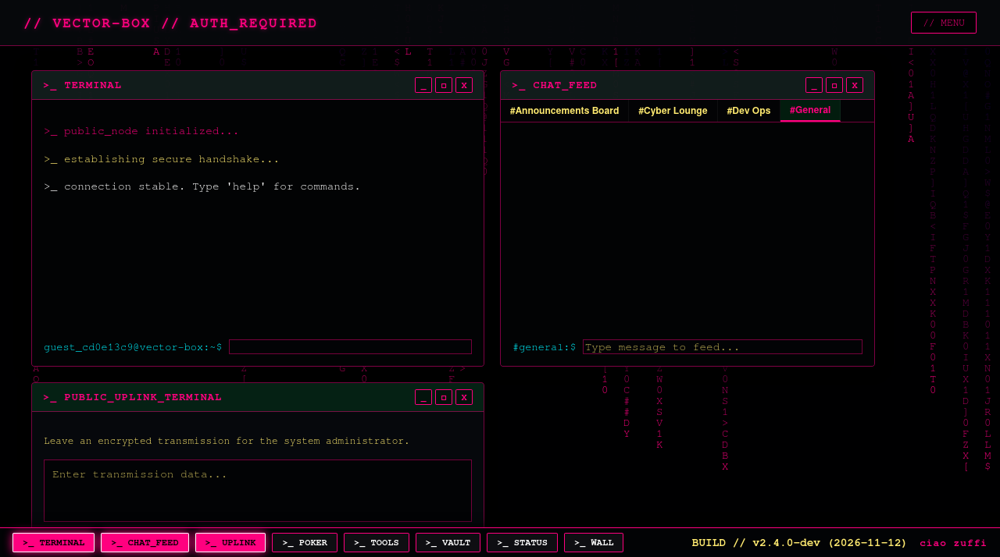
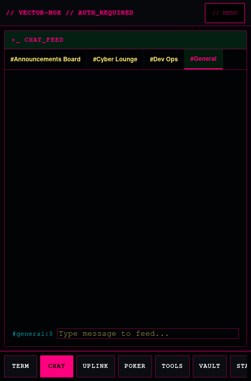
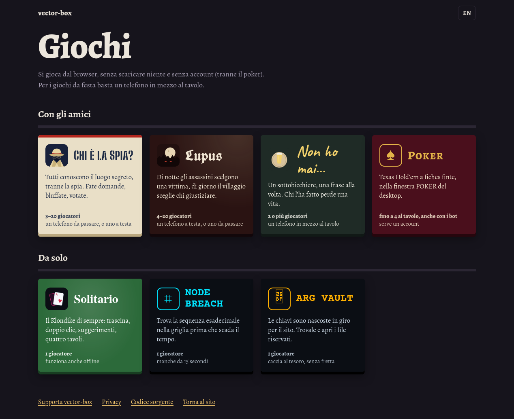
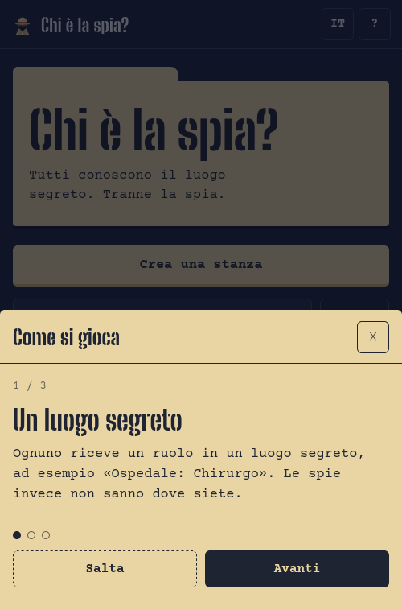
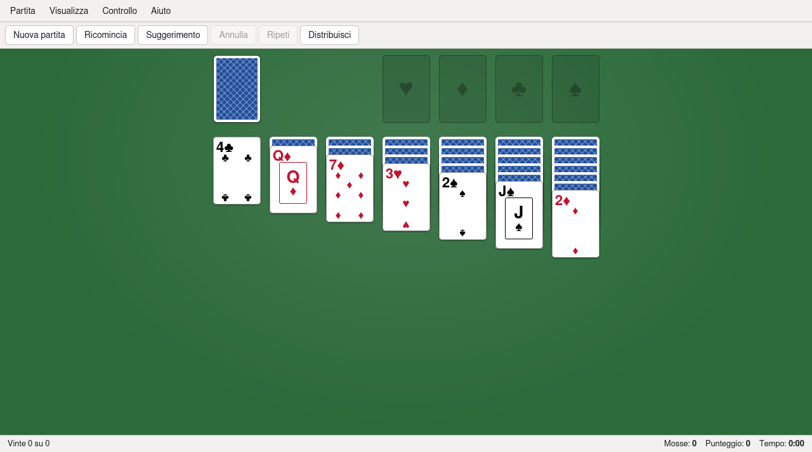

# vector-box — documentazione

> Aggiornata al 2026-11-12 (schema del database **v12**, 140 test). Codice: <https://github.com/G1anPietro/vector-box>

vector-box è un sito personale in stile desktop cyberpunk: finestre, terminale e barra delle applicazioni nel browser.
Dentro ci sono una chat con stanze e messaggi privati, un lettore di libri privato, giochi da festa per telefono e giochi
da soli. Gira su un piccolo server di casa (Ubuntu, nginx, PHP-FPM, Node.js).



**Indice:** [Guida per chi usa il sito](#parte-1--guida-per-chi-usa-il-sito) ·
[Comandi del terminale](#comandi-del-terminale) ·
[Documentazione tecnica](#parte-2--documentazione-tecnica) · [API](#5-api) · [Sicurezza](#6-sicurezza) ·
[Configurazione](#7-configurazione-env) · [Sviluppo](#8-sviluppo-in-locale) · [Pubblicazione](#9-pubblicazione-sul-server)

---

# Parte 1 — Guida per chi usa il sito

## Il desktop

La home è un desktop: ogni funzione è una **finestra** che si apre dalla barra in basso, si trascina, si riduce, si
ingrandisce e si chiude. Il **MENU** in alto a destra porta alle altre pagine (Giochi, Supporta, accesso, impostazioni
dell'account) e ai temi grafici.

| Finestra | A cosa serve |
|---|---|
| **TERMINAL** | Riga di comando: `help` mostra tutti i comandi (elenco più sotto). |
| **CHAT_FEED** | La chat pubblica, divisa in stanze (le schede in alto). |
| **UPLINK** | Lascia un messaggio privato a chi gestisce il sito: arriva come notifica sul suo telefono. |
| **POKER** | Texas Hold'em con fiches finte, contro altri giocatori e bot (serve un account). |
| **TOOLS** | Strumenti: banner ASCII, ROT13/ROT47, cifrario di Cesare, Morse, binario. |
| **VAULT** | Il caveau dell'ARG: inserisci le chiavi trovate in giro per il sito. |
| **STATUS** | Stato del server: da quanto è acceso, carico, memoria, servizi. |
| **WALL** | Il muro dei graffiti: lascia una frase visibile a tutti. |
| **DM** | Messaggi privati con gli altri utenti registrati. |
| **READER** | La biblioteca (solo per gli account autorizzati). |

**Sul telefono** si vede un'app alla volta, e si cambia con la barra di schede in basso (scorre di lato). Mentre la tastiera
è aperta la barra si nasconde, poi torna.



## Account

- **Senza account** puoi leggere la chat, scrivere come ospite (`guest_` più 8 caratteri), usare il terminale e giocare
  ai giochi da festa.
- **Con un account** (MENU → LOGIN / REGISTER; password di almeno 8 caratteri) hai il tuo nome in chat, i messaggi
  privati, il poker con la classifica e il tema grafico che resta.
- La **biblioteca** e il **curriculum** si vedono solo se l'admin ti dà il permesso (`/grantbook`, `/grantcv`).

## Chat e messaggi privati

- Scegli la stanza dalle schede in alto. Alcune stanze sono solo per gli annunci (scrive solo l'admin).
- Scrivi `@nome` per menzionare qualcuno: il messaggio si evidenzia e, se ha la scheda in background, riceve una notifica.
- Quando il collegamento in tempo reale è attivo, sotto la chat vedi chi è online e chi sta scrivendo.
- **Messaggi privati (DM):** cerca un utente per nome e scrivigli. Puoi **bloccare** qualcuno: nessuno dei due potrà più
  scrivere all'altro. Scorrendo verso l'alto i messaggi più vecchi si caricano da soli. L'admin non ha un modo per leggerli.

## Biblioteca

Per chi ha il permesso: libri **EPUB** e **PDF** con copertina, scaffale "Continua a leggere", avanzamento salvato,
segnalibri, quattro colori di pagina e luminosità. Chi può caricare sceglie più file insieme o li trascina sul riquadro.

## Giochi

Tutti i giochi sono nella pagina **Giochi** (MENU → GIOCHI), in italiano e inglese.



- **Chi è la spia?** (3–20 giocatori): tutti conoscono il luogo segreto tranne le spie. Si fanno domande a turno, poi si
  vota; la spia può provare a indovinare il luogo. Si gioca con un telefono a testa (stanza con un codice di 4 lettere) o
  con un solo telefono da passare. Nelle impostazioni della stanza: numero di spie, categorie di luoghi, modalità famiglia.
- **Lupus** (4–20 giocatori): di notte gli assassini scelgono una vittima, di giorno il villaggio vota chi giustiziare.
  Ruoli della casa (puttana, joker, pescatore, giudice) e ruoli facoltativi (veggente, guardia, strega, cacciatore…).
- **Non ho mai…** (2 o più): un telefono in mezzo al tavolo, una frase alla volta; chi l'ha fatto perde una vita.
- **Cucù** (2–20, un telefono a testa): una carta a testa dal mazzo italiano. Il nuovo mazziere dice a voce le vite di
  tutti (se ne sbaglia una perde una vita e passa il mazzo); le carte si guardano dopo che il mazziere **bussa due volte**;
  a turno si tiene o si cambia col vicino, il **Re blocca** lo scambio («Cucù!»), il mazziere per ultimo può cambiare col
  mazzo; la carta più bassa perde una vita (pari merito: si ripesca). **Le vite non si vedono**, si ricordano a memoria;
  ogni vita persa o guadagnata compare su tutti i telefoni. Chi crea la stanza è il **capotavola**: conferma chi perde,
  segnala chi parla con i morti (il vivo perde una vita, il morto ne guadagna una; il mazziere può parlarci). Poteri
  facoltativi nelle impostazioni (Cavallo che salta, Re pescato dal mazzo) e un "potere dell'admin" dichiarato a tutti.
- **Solitario**: Klondike. Si gioca toccando o trascinando le carte; doppio clic per mandarle sulle pile dei semi (doppio
  clic su una pila raccoglie tutto quello che può salire). Suggerimento, annulla/ripeti, punteggio, quattro tavoli
  (Classico, Neon, Legno, Notte). Sul computer ha menu e scorciatoie: Ctrl+Z, Ctrl+Y, H (suggerimento), D (distribuisci),
  F2 (nuova partita).
- **Node Breach**: trova la sequenza esadecimale nella griglia in 15 secondi.
- **ARG Vault**: le chiavi sono nascoste in giro per il sito.
- **Poker**: per ora è la finestra POKER del desktop.

 

## Comandi del terminale

Si scrivono nella finestra TERMINAL. `help <comando>` spiega un comando.

| Gruppo | Comandi |
|---|---|
| **File (finti, solo nel browser)** | `ls`/`dir`, `cd`, `pwd`, `cat`, `nano`, `mkdir`, `touch`, `echo … > file`, `rm`, `find`, `grep` |
| **Sistema e rete** | `whoami`/`id`, `uptime`, `history`, `ip` (il tuo IP pubblico), `ping`, `traceroute`, `scan`, `nmap`, `status`, `fetch` |
| **Aspetto** | `theme <nome>` (cyberpunk, nord, catppuccin, gruvbox, dracula, synthwave, solarized), `rice`, `matrix <colore>`, `cmatrix`, `glitch`, `nuke`, `clear` |
| **Chat** | `rooms`, `join <stanza>`, `create <id> [nome]`, `whois <utente>` |
| **Finestre e giochi** | `poker …`, `vault`, `tools`, `hack` |
| **Varie** | `fortune`/`quote`, `ascii <testo>`, `decrypt`, `sudo` |
| **Solo admin** | `/ban <utente>`, `/timeout <utente> [minuti]`, `/unban <utente>`, `/grantbook`/`/revokebook <utente>` (biblioteca), `/grantcv`/`/revokecv <utente>` (curriculum), `syslog` (log degli errori) |

---

# Parte 2 — Documentazione tecnica

## 1. Panoramica

| Parte | Cosa fa |
|---|---|
| **Desktop** (`public/index.php`) | Finestre trascinabili; su telefono un'app alla volta (`js/mobile.js`, `css/mobile.css`). |
| **Terminale** | `js/terminal.js`, `js/commands.js`, `js/admin_commands.js`. |
| **Chat** | Stanze pubbliche, private (solo l'admin scrive) e nascoste (solo l'admin legge). |
| **Messaggi privati** | `api/dm.php`, `js/dm.js`. Nessuna via di accesso per l'admin nelle API. |
| **Lettore di libri** | `pages/reader.php`, `js/reader.js` (epub.js e pdf.js da CDN), `api/books.php`. |
| **Giochi** | Pagine statiche (`pages/spia.html`, `lupus.html`, `nonhomai.html`, `solitario.html`) con motori lato server per le stanze (`api/spia_lib.php`, `api/lupus_lib.php`). |
| **Pagine pubbliche** | Giochi, Supporta (`ads.php`), Privacy, Credits. Curriculum (`resume.php`) privato. |
| **Hub Node** (`server.js`) | Facoltativo: chat in tempo reale con una sola connessione SSE per browser. |

## 2. Architettura

```
 browser ──HTTPS──► nginx ─┬─► PHP-FPM ── public/ (pagine e API) ──► SQLite (data/vector_uplink.sqlite)
                           │                     │
                           │                     └─ notifica i messaggi nuovi ──► hub Node (127.0.0.1)
                           └─ /api/chat/stream ─────────────────────────────────► hub Node (SSE)
```

- **PHP è la fonte di verità**: salva ogni messaggio, gestisce account, permessi e giochi.
- **Node** (`server.js`) è opzionale: riceve da PHP i messaggi nuovi/cancellati (`/internal/chat/publish`, solo da
  loopback e con un segreto condiviso) e li spinge ai browser collegati a `/api/chat/stream`. Senza Node la chat usa lo
  stream PHP (`api/uplink_stream.php`). Node contiene anche un vecchio pannello di controllo (Minecraft, Wake-on-LAN) da
  non esporre.
- **Pagine statiche dei giochi**: funzionano anche offline nel browser e parlano con il server solo tramite `api/spia.php`.
- `data/` sta **fuori** dalla cartella pubblicata: database, sessioni PHP, libri, copertine, log, registro visite.
- **Registro visite**: `includes/head.php` (pagine PHP) e `api/visit.php` (pagine statiche) chiamano `recordVisit()`;
  una visita è "nuova" dopo 30 minuti di assenza: una riga in `data/visits.log` e una notifica ntfy.

## 3. Struttura delle cartelle

```
public/            radice del sito (l'unica cartella servita da nginx)
  index.php        il desktop
  pages/           pagine: giochi, lettore, curriculum, privacy, supporta, giochi statici
  api/             endpoint JSON e librerie condivise (helpers, database, rate limiter, motori dei giochi, visite)
  includes/        head.php (intestazioni di sicurezza, versione, registro visite), ads.php
  js/ css/ assets/ script, stili, icone, font self-hosted
lib/               codice condiviso con i test
server.js          hub Node / pannello
tests/             test automatici (node:test)
tools/backup.sh    backup notturno
updatesite.sh      aggiornamento del sito sul server
data/              (non in git) database, sessioni, libri, copertine, log
```

## 4. Database

SQLite in modalità WAL. Lo schema ha una versione (`PRAGMA user_version`, oggi **11**): le modifiche sono funzioni
`migrateVN()` in `public/api/database.php`, eseguite una sola volta sotto lock.

| Versione | Cosa aggiunge |
|---|---|
| V1 | account, stanze, messaggi (`transmissions`), poker, libri, avanzamento lettura, limiti di richieste |
| V2 | `books.meta_checked` (riparazione dei metadati EPUB) |
| V3 | `guestbook` (muro dei graffiti) |
| V4 | `bookmarks` (segnalibri) |
| V5 | `poker_stats` (classifica) |
| V6 | stanze di Chi è la spia? (`spia_rooms`, `spia_devices`, `spia_players`, `spia_rounds`, `spia_assign`, `spia_votes`) |
| V7 | stanze multi-gioco e `lupus_games` (stato della partita in JSON) |
| V8 | messaggi privati (`dm_messages`, `dm_blocks`) |
| V9 | `visitors` (registro visite); riprova le copertine EPUB mancanti |
| V10 | `accounts.can_view_resume` (curriculum privato) |
| V11 | `cucu_games` (stato delle partite di Cucù in JSON) |

**Regole:** mai DDL fuori dalle migrazioni; ogni modifica = nuova `migrateVN()` + `DB_SCHEMA_VERSION` + chiamata in
`runMigrations()` + `EXPECTED_SCHEMA` in `updatesite.sh`. Sul server il database non va aperto con `sqlite3` da un utente
diverso da quello di PHP (in WAL crea file `-shm`/`-wal` che poi PHP non può aprire): usare una copia.

## 5. API

Tutte in `public/api/`, rispondono in JSON (`{"success": true|false, …}`; in caso di errore `"error"` con un messaggio
generico). Le richieste che modificano qualcosa vogliono l'intestazione `X-CSRF-Token`, che `js/csrf.js` aggiunge da solo
a ogni `fetch` verso il sito (il token arriva da `check_session.php`).

**Chi:** *tutti* = anche gli ospiti; *utenti* = sessione (anche ospite con nome `guest_…`); *registrati* = account vero;
*autorizzati* = account con il permesso della biblioteca; *admin* = `is_admin`.

### Sessione e account

| Endpoint | Chi | Richiesta | Risposta |
|---|---|---|---|
| `check_session.php` | tutti | GET | `logged_in`, `username`, `user_id`, `is_admin`, `csrf_token`, `chat_stream` (`url`, `token` monouso da 60 s) |
| `login.php` | tutti | POST `{username, password}`; registrazione `{action:"register", username, password}` | `username`, `is_admin`, `theme`, `csrf_token`. Limiti: 10 tentativi/5 min per IP, 5 per utente; 5 registrazioni/ora per IP |
| `logout.php` | tutti | GET o POST (rifiutato se parte da un altro sito) | redirect a `pages/login.php`, o JSON con `Accept: application/json` |
| `save_theme.php` | registrati | POST `{theme}` | `theme` |
| `get_user_profile.php` | tutti | GET `?username=` | `username`, `is_admin`, `created_at`, `bio` |
| `get_ip.php` | tutti | GET | `ip` |

### Chat

| Endpoint | Chi | Richiesta | Risposta |
|---|---|---|---|
| `rooms.php` | tutti / admin | GET: elenco (le nascoste solo all'admin). POST (admin) `{id, name, is_private, is_hidden}` | `rooms` / `room` |
| `get_feed.php` | tutti* | GET `?room_id=&limit=&before_id=` | `messages`, `has_more`, `latest_id` |
| `uplink_send.php` | utenti | POST `{room_id, message}` | il messaggio salvato (nelle stanze private scrive solo l'admin) |
| `uplink_stream.php` | tutti* | GET `?last_id=` (SSE) | flusso di messaggi, riprende dall'ultimo id |
| `delete_message.php` | admin | POST `{id}` | `id`, `room_id` |
| `chat_typing.php` | utenti | POST `{room_id}` | segnale "sta scrivendo" (solo via hub, non salvato) |
| `command.php` | tutti (CSRF) | POST `{message}` (max 500 caratteri, 2 ogni 30 s) | invia una notifica ntfy all'admin |

\* le stanze nascoste sono escluse per chi non è admin.

### Messaggi privati — `dm.php` (registrati)

| Richiesta | Risposta |
|---|---|
| GET `?action=conversations` | le mie conversazioni (ultimo messaggio, non letti) |
| GET `?action=thread&with=ID[&before=ID]` | 50 messaggi con un utente in ordine cronologico, `more` se ce ne sono altri; segna come letti |
| GET `?action=since&after=ID` | i miei messaggi più nuovi di ID (polling) |
| GET `?action=users&q=TESTO` | utenti registrati il cui nome inizia con TESTO |
| GET `?action=blocks` | utenti che ho bloccato |
| POST `{action:"send", to, body}` · `{action:"block"|"unblock", user_id}` | esito |

### Biblioteca (autorizzati)

| Endpoint | Richiesta | Risposta |
|---|---|---|
| `books.php` | GET `?q=` (catalogo; ripara al massimo 3 copertine per richiesta) | `books`, `can_read`, `can_upload` |
| `books.php` | GET `?action=stream&id=` / `?action=download&id=` / `?action=cover&id=` | il file (le copertine solo jpg/png/gif/webp) |
| `books.php` | POST `?action=upload`, multipart `book_file` (chi ha `can_upload_books`) | `.epub` o `.pdf` con controllo del contenuto vero; limite 64 MB (nginx) |
| `progress.php` | GET `?book_id=` o `?all=1`; POST `{book_id, cfi_or_page, percentage}` | avanzamento di lettura |
| `bookmarks.php` | GET `?book_id=`; POST `{action:"add", book_id, location, label, percentage}` · `{action:"delete", id}` | segnalibri (max 100 per libro) |
| `moderate_book_access.php` | admin: POST `{action:"grant"|"revoke", username, scope:"books"|"resume"}` | permesso di biblioteca o curriculum |

### Giochi

| Endpoint | Chi | Richiesta |
|---|---|---|
| `spia.php` | tutti (telefono identificato dall'intestazione `X-Spia-Device`) | GET `?action=state` (vista di questo telefono, ogni ~2 s); POST `{action}`: `create`, `join`, `leave`, `kick`, `host`, `take`, `player_add`, `player_remove`, `settings`, `start`, `seen`, `vote_call`, `vote`, `vote_close`, `guess`, `end`, `reset_scores`; le azioni di Lupus per le stanze `game:"lupus"`; per `game:"cucu"`: `recite {ok}`, `knock`, `keep`, `swap`, `deck`, `confirm {player_id}`, `life {player_id, delta}`, `talk {player_id, dead_id}`, `admin_power {player_id}` (motore in `api/cucu_lib.php`) |
| `poker.php` | utenti | GET `?action=state`; POST `?action=` `create_room`, `join`, `leave`, `deal`, `play` |
| `poker_leaderboard.php` | tutti | classifica (`top`, e `me` se hai fatto l'accesso) |
| `guestbook.php` | tutti / admin | GET: ultime frasi; POST `{action:"sign", message}` · admin `{action:"delete", id}` |
| `visit.php` | tutti | GET `?p=/pages/…` → 204 (registro visite delle pagine statiche) |

### Amministrazione e stato

| Endpoint | Chi | Cosa fa |
|---|---|---|
| `moderate_user.php` | admin | POST `{action:"ban"|"timeout"|"unban", username, minutes}` |
| `get_log.php` | admin | log degli errori (contiene IP) |
| `status.php` | tutti | uptime, carico, memoria, servizi di `STATUS_CHECKS` (solo i nomi) |
| `telemetry.php` | tutti | percentuali di CPU e RAM |

Le librerie (`helpers.php`, `database.php`, `rate_limiter.php`, `epub_meta.php`, `spia_lib.php`, `lupus_lib.php`,
`visits.php`, `debug_logger.php`) non sono endpoint: se richieste direttamente definiscono solo funzioni.

## 6. Sicurezza

- **Sessioni:** cookie `HttpOnly`, `Secure` (in HTTPS), `SameSite=Lax`, modalità strict (ID inventati rifiutati), ID
  rigenerato al login. `initSession()` apre e chiude subito (sola lettura); chi scrive in sessione usa `initSession(true)`
  e `session_write_close()`.
- **CSRF:** ogni endpoint che modifica chiama `requireCsrf()`; quelli admin anche `requireAdmin()`. Il logout (un link)
  rifiuta le richieste che partono da altri siti (`Sec-Fetch-Site`).
- **Errori:** mai il messaggio dell'eccezione al browser: `failInternal()` scrive nel log e risponde in modo generico.
- **IP del client:** solo con `getClientIp()`; `X-Forwarded-For` vale solo dai proxy in `TRUSTED_PROXIES`.
- **XSS:** il testo degli utenti entra con `textContent`, mai `innerHTML` o `onclick` inline.
- **Content-Security-Policy** (`sendPageSecurityHeaders()`): `CSP_ENFORCE=true` per applicarla; le pagine con annunci
  (`VB_ADS_PAGE`) aprono solo i domini di Google necessari, e solo con `ADSENSE_CLIENT` impostato.
- **Limiti di richieste** in SQLite (`checkRateLimit()`): login, registrazione, chat, messaggi privati, guestbook,
  modulo per l'admin, beacon delle visite, stanze dei giochi.
- **Hub della chat:** token firmato (HMAC), valido 60 secondi e per **una sola** connessione.
- **File caricati:** estensione e contenuto vero controllati, nome ripulito, salvati fuori dalla cartella pubblica.
- **Biblioteca e curriculum privati:** solo per gli account con il permesso; `robots.txt` tiene fuori i motori di ricerca.

## 7. Configurazione (`.env`)

Si parte da `.env.example`, che spiega ogni voce.

| Variabile | A cosa serve |
|---|---|
| `SESSION_SECRET`, `ADMIN_PASSWORD`, `GUEST_PASSWORD` | obbligatorie per Node |
| `TRUSTED_PROXIES` (PHP), `TRUST_PROXY` (Node) | proxy fidati per l'IP del client |
| `NTFY_TOPIC_URL` | notifiche del modulo "messaggio all'admin" |
| `CHAT_HUB_SECRET`, `CHAT_STREAM_URL`, `CHAT_HUB_INTERNAL_URL`, `CHAT_STREAM_CORS_ORIGIN`, `PORT`, `BIND_HOST` | hub della chat |
| `CSP_ENFORCE` | applica la Content-Security-Policy |
| `STATUS_CHECKS` | servizi mostrati nella finestra STATUS (max 8) |
| `ADSENSE_CLIENT`, `ADSENSE_SLOT_GAMES`, `ADSENSE_SLOT_SUPPORT` | annunci (spenti se vuoti), vedi `docs/ADSENSE.md` |
| `CONTACT_EMAIL` | contatto nella pagina privacy |
| `VISIT_NTFY_URL`, `VISIT_NOTIFY`, `VISIT_GAP_MIN`, `VISIT_NOTIFY_MAX_PER_HOUR` | registro visite e notifiche |
| `MC_DIR`, `WAKE_SCRIPT` | vecchio pannello Node (Minecraft, Wake-on-LAN) |

## 8. Sviluppo in locale

```bash
cp .env.example .env              # e riempirlo
npm install
php -S 127.0.0.1:8080 -t public   # PHP_CLI_SERVER_WORKERS=4 per provare SSE e concorrenza
npm start                         # hub Node (facoltativo)
npm test                          # 101 test: account, CSRF, stanze, chat, hub, giochi, DM, visite, permessi…
```

I test (`tests/*.test.js`) avviano ogni volta una **copia** del sito in una cartella temporanea con un database vuoto
(`tests/helpers.js`: `startSite()`, `Client`, `makeAdmin()`). Prima di ogni commit: `npm test`, `php -l` sui file PHP
toccati e `node --check` sui JS. Mai lavorare sul database vero.

**Requisiti:** PHP 8.x con `pdo_sqlite`, `curl`, `zip` e `xml` (le ultime due per copertine e autori degli EPUB),
`mbstring` consigliata (senza, il sito usa le sue funzioni `textLength()`/`textCut()`); Node.js 22 (usato sul server).

## 9. Pubblicazione sul server

`sudo bash updatesite.sh` sul server: scarica `main`, mette da parte eventuali modifiche locali, aggiorna le dipendenze
Node se cambiate, sistema i permessi di `data/`, esegue le migrazioni come utente di PHP, riavvia l'hub se gira sotto PM2,
scrive la versione (`version.php`, usata per i `?v=` dei file) e controlla che lo schema sia quello atteso. Serve un `.env`
già presente. Dettagli e configurazione nginx: `docs/DEPLOY.md`; backup: `docs/BACKUP.md`; annunci: `docs/ADSENSE.md`.

## 10. Come si fa…

- **Aggiungere un gioco alla pagina Giochi:** una voce nell'elenco `$GAMES` in cima a `public/pages/giochi.php`
  (gruppo, colori, link, icona, testi IT/EN) e lo stile della "scatola" in `public/css/giochi.css`. Per le pagine statiche
  nuove: `<script src="../js/visit.js?v=1" defer></script>` per il registro visite.
- **Aggiungere una tabella o una colonna:** nuova `migrateVN()` (sezione 4).
- **Aggiungere un endpoint che modifica dati:** `requireCsrf()` (e `requireAdmin()` se serve), `failInternal()` per gli
  errori, `checkRateLimit()` se può essere abusato, e un test in `tests/`.
- **Aggiungere un permesso per account** (come biblioteca e curriculum): colonna in una migrazione, controllo nella pagina,
  uno `scope` in `moderate_book_access.php`, comandi in `js/admin_commands.js` e `js/commands.js`.
- **Aggiungere testi tradotti ai giochi:** chiavi in `public/js/spia/i18n.js` per tutte e 5 le lingue (it, en, es, fr, de).
- **Cambiare un file CSS/JS di una pagina statica:** alzare a mano il suo `?v=` (le pagine PHP lo fanno da sole).

## 11. Limiti noti

- Il pannello Node (Minecraft, Wake-on-LAN) è vecchio e non va esposto.
- La pagina Doom non funziona.
- Il poker è ancora una finestra del desktop: va rifatto come pagina della sezione Giochi.
- Le cancellazioni dei messaggi arrivano in tempo reale solo con l'hub Node attivo.
